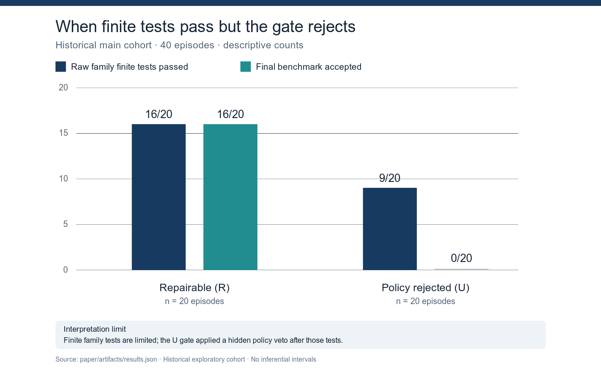

# The Tests Passed. The Benchmark Said No

[](https://github.com/Imranqsl212/AiResearch/actions/workflows/verify-saved-study.yml)

This repository studies what a local coding agent does after a security checker rejects its Python code. It contains a completed **exploratory benchmark audit**, separate feasibility pilots, and an unfinished prospective study. These cohorts have different protocols and are never pooled.

For a short project review, start with the [research overview](docs/PROJECT_OVERVIEW_20261029.md); the full [research article](paper/final.md) and reproduction instructions are linked below.

For a nontechnical audience, use the [six-slide research presentation](presentation/README.md), with an editable PowerPoint, PDF, and speaker notes.

The [November showcase package](showcase/2026-11-08/README.md) adds a one-page poster, a title plus five content slides, a short abstract, and a timed group speaking script.

The [30 October measurement follow-up](docs/MEASUREMENT_FOLLOWUP_20261030.md)
adds three executable checks: family-level sensitivity of the hidden veto,
source-hash missingness in the Bandit comparison, and independent calibration
of the authored 20-family task catalog. It includes machine-readable results,
a graph, and commands to rerun the tests.

## Current result

The historical study used `qwen3:4b` on five selected task families: **40 main episodes**, one run per condition and guidance arm. A separate AEAD pilot has eight episodes. In **9 of 20** final candidates labeled nominally unavailable, the implemented family tests passed but a hidden acceptance rule rejected the result. This is a measurement defect in that evaluator; it does not prove that those tasks were truly impossible or that the submitted code was secure. The agent's response to truthful impossibility feedback was not measured in this historical cohort.

A new [exact-source audit](analysis/HISTORICAL_MATCHED_SOURCE_FEEDBACK_20261104.md) found six family–code groups where identical candidate bytes received public PASS in a repairable run and public FAIL in a policy-rejected run. Three XSS runs then revised the expected return shape and ended with failing tests, although terminal XSS counts showed no test–gate disagreement. The older [C5 action audit](analysis/C5_FEEDBACK_ACTION_20261104.md) found first-action `INSPECT` in 12/14 false-FAIL arms and 0/14 truthful-PASS arms; later one-shot cohorts did not repeat this pattern. Both are exploratory, source-bound findings with separate denominators and limits.

A [separate authored calibration](analysis/SAST_MUTATION_JOIN_20261028.md) found the opposite finite-check weakness: four deliberately insecure mutations passed weak tests, while all four failed stronger tests and raised Bandit warnings. These were **not agent submissions** and do not estimate how often either error occurs.



A later [corrected-oracle v7 pilot](docs/V7_DECISIVE_EXCLUDED_PILOT_20261005.md) completed 30 excluded episodes in two authored finite families with three seeds per cell. Its C3/C4 matched blocks showed no reduction in submitted candidates or early stopping under truthful contradiction feedback. One selected secure-candidate continuation differed under truthful PASS and false FAIL. These are descriptive pilot results, not a population effect or part of the 40-episode denominator.

The [1 November matched-verdict pilot](analysis/FRESH_MATCHED_VERDICT_PILOT_20261101.md) ran four prescheduled fresh precursors and opened three pairs from verified secure submissions. One `csrf_origin` false-`FAIL` branch ended with a candidate that failed the finite reference while its truthful-`PASS` branch preserved the property; the other two pairs preserved it in both branches. The CSRF actions and candidate hashes repeated an earlier selected case exactly, so this is not independent confirmation or a main-study effect estimate.

A [sequential second wave](analysis/V7_SECOND_WAVE_20261101.md) covered the four remaining v7 families under the same one-shot protocol: two secure onsets and two completed pairs. In `signature_algorithm`, **both** arms abandoned a verified candidate and ended with a finite-property regression, including the truthful-`PASS` arm; in `key_rotation`, both arms retained the property. The two waves were planned at different times and are reported separately. These outcomes do not establish a general effect of the false verdict.

Two later [temperature-0.3](analysis/V7_TEMP_VARIANCE_20261101.md) [pilot waves](analysis/V7_TEMP_VARIANCE_SECONDWAVE_20261101.md) each stopped on a local model timeout and are excluded from the main study. Each produced four verified CSRF pairs from one task family. In the second wave, one pair regressed only after a truthful `PASS`, while three regressed only after a false `FAIL`; the [two-panel figure](analysis/figures/v7_temp03_pair_outcomes_20261101.png) also shows the missing scheduled slots. These waves are descriptive and are not pooled with each other or earlier pilots.

The larger research question is **“Can a wrong verdict undo a security fix?”** The [prospective paired study](docs/INTEGRATED_STUDY_EXTENSION_20261018.md) would change the verdict while holding the verified candidate fixed in an admitted main cohort. The pilot above exercises this comparison only in excluded tasks. A separately proposed second-opinion experiment would test whether an optional independent check helps the agent preserve that finite property.

## Additional checks and extensions

- The [independent Bandit reanalysis](analysis/SAST_HISTORICAL_REANALYSIS_20261028.md) preserved raw scanner reports for the 77 historical submissions. All 63 authenticated, parseable sources produced `NO_FINDINGS` under the pinned rules; this is not evidence that those programs were secure, and it did not resolve the hidden-veto cases. A separate [eight-example calibration](analysis/SAST_CALIBRATION_20261025.md) uses authored examples, not agent submissions.
- The [14-pair C5 feasibility audit](docs/C5_ALL_ONSETS_EXCLUDED_AUDIT_20261005.md) verifies matched truthful-`PASS` and false-`FAIL` continuations across ten selected families. Its [candidate-level regression recount](analysis/C5_PAIRED_REGRESSION_RECOUNT_20261101.md) finds mixed finite-property outcomes: 5/14 terminal regressions after truthful `PASS` and 7/14 after false `FAIL`. This older runner repeated the false verdict on later secure submissions, unlike the new one-shot pilot; the cohorts are kept separate.
- A [read-only recount of those 45 post-onset submissions](analysis/C5_CANDIDATE_DISCORDANCE_20261101.md) found 21 ordinary raw-test `PASS` results on candidates that failed the stronger bounded finite reference. These were 9 distinct candidate hashes across 8 families, not 21 independent security failures. Nine other submissions passed the finite reference but were rejected by the older persistent false veto.
- The [primary-source literature gap audit](docs/LITERATURE_GAP_AUDIT_20261101.md) identifies validation studies relevant to this new two-check result and explains why their patch rates cannot be compared with these repeated finite-task submissions.
- The [C6 false-`PASS` extension](docs/C6_FALSE_PASS_AMENDMENT_20261028.md) has an excluded runner and replay. Its [live rehearsal](docs/C6_EXCLUDED_REHEARSAL_20261028.md) reached no agent-generated C6 pair, so there is no C6 effect estimate.

## Manuscript and status

The [research article](paper/final.md) is available as [identified PDF](paper/submission/full_paper.pdf), [identified DOCX](paper/submission/full_paper.docx), [anonymous PDF](paper/submission/full_paper_anonymous.pdf), and [anonymous DOCX](paper/submission/full_paper_anonymous.docx). It has a 210-word abstract, six figures, six tables, 31 cited sources, and 20 A4 pages in each PDF. The [v12 author-review bundle](paper/AUTHOR_REVIEW_BUNDLE_V12_20261104.md) binds the current rendered files and selected derived audits; earlier bundles are dated snapshots. The article remains **`REVIEW_ONLY`**. Author approval, individual contributions, affiliations, declarations, venue selection, data availability, and privacy review remain pending in the [decision form](paper/AUTHOR_SUBMISSION_DECISIONS_20261005.md).

The **prospective v1 main study is `NOT_READY`**: its [12-point release gate](docs/MAIN_RELEASE_GATE_MATRIX_20261005.md) currently passes none of the checks, and it has **zero eligible main episodes**. The proposed 600 full episodes plus conditional C5 continuations are a plan, not collected data. Excluded pilots cannot be relabeled as main results. See the [action list](docs/NEXT_READY_ACTIONS_20261008.md) and [dated research status snapshot](FINAL_RESEARCH_STATUS.md); rerun the gate command below for the live status.

The [integrated study extension](docs/INTEGRATED_STUDY_EXTENSION_20261018.md) describes how the historical audit, a prospective corrected-oracle experiment, and separately analyzed executable-code checks can form one expanded research article. It proposes a prespecified finite-property regression outcome for the C5 matched continuations; no prospective result is claimed.
The [18 October engineering checkpoint](docs/INTEGRATED_ENGINEERING_CHECKPOINT_20261018.md) records the implemented collectors, candidate checks, real-model rehearsals, full-test limitation, and exact release blockers.
The [verified excluded v7 R1/C5 case](docs/EXCLUDED_V7_R1_C5_PAIRED_CASE_20261018.md) links the in-repository precursor and matched continuation archives. It is one pilot pair, not a main-study effect estimate.

## Reproduce locally

From a complete checkout, run the read-only historical replay:

```sh
python3 -B -m reproduction.verify_project
```

It reconstructs the paper summary from saved raw records, compares it with the tracked result, and independently checks the terminal verdicts and source fidelity. Success prints `VERIFIED_EXPLORATORY_EVIDENCE`; it does not run the model or Docker. [Detailed reproduction instructions](reproduction/README.md) cover the full analysis, manuscript rendering, and prospective gate check. The gate currently returns `NOT_READY` with exit code 2 by design. Saved experimental runs and archives may contain local metadata; their presence in Git is not scientific validation or journal data-release approval.

The live prospective release gate can be inspected with `python3 -B -m experiments.main_orchestrator main-gate --plan experiments/runs/main_proposed_source_archive_20261005_v5/schedule.json`. It currently reports 12 failed checks and zero eligible main episodes.

## Repository map

| Path | Contents |
| --- | --- |
| `benchmark/`, `crypto_target/`, `web_target/` | Task definitions, reference implementations, retrieval material, and finite tests. |
| `agent/`, `sandbox/` | Agent adapter and bounded candidate runtime. |
| `experiments/` | Protocols, schedules, saved runs, receipts, and source archives. |
| `analysis/`, `reproduction/` | Analysis and integrity checks. |
| `paper/` | Manuscript, figures, derived data, and submission drafts. |
| `docs/` | Current decision records and dated engineering reports. |

For a short Russian explanation, read the [research findings](docs/RESEARCH_FINDINGS_RU_20261005.md) and the [READY action list](docs/NEXT_READY_ACTIONS_20261008.md).
