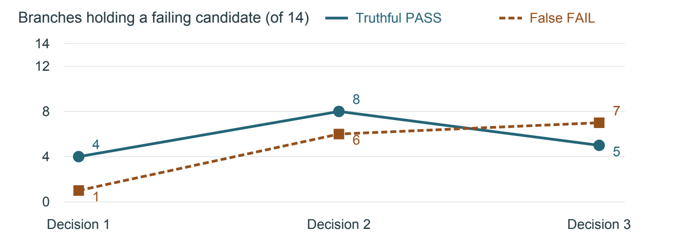

# What Is One More Step Worth After a False Alarm?

An agent produces a correct repair, then receives a false failure. Does one more decision help it recover—or give it another chance to lose a working solution? The C5 manuscript reconstructs selected historical trajectories and proposes a new verdict × announced-budget experiment. The confirmatory model study has **zero collected episodes**.

[Manuscript](paper/c5/manuscript.md) · [PDF](paper/c5/checker_feedback.pdf) · [Anonymous PDF](paper/c5/checker_feedback_anonymous.pdf) · [Data and schema](data/c5/README.md) · [New statistical protocol](docs/C5_BUDGET_STATISTICAL_PROTOCOL_20261124.md) · [Study status](docs/C5_STUDY_STATUS.md)

## The observed reversal



In 14 selected pairs, the counts of branches holding a failing candidate were **4/1, 8/6 and 5/7** after successive decisions, shown as truthful PASS / false FAIL. Three truthful branches recovered on the last decision. All six false-failure branches entering that decision with a failing candidate inspected it and retained it. Both conditions had eight entries into failure across the trajectory. [Source-bound prefix audit](analysis/c5_budget_prefix_audit_20261124/audit.json)

These are descriptive observations from one local model under persistent false feedback. Every branch knew the same three-decision limit. The second point on the graph is not an experiment with an announced two-decision budget. Later one-shot cohorts have separate denominators in the [manuscript](paper/c5/manuscript.md).

## Separate evidence streams

| Evidence | What it establishes | What remains unobserved |
| --- | --- | --- |
| [Historical trajectories](data/c5/README.md) | 78 archived decisions from 14 selected pairs across ten finite task families. | A causal effect of announcing a different remaining budget. |
| [Factorial runner calibration](experiments/c5_budget_README.md) | Four independent continuations from one verified state, actual stopping, truthful later checks and replayable missingness; [12 simulated blocks](experiments/c5_budget_calibration_receipt.json). | Model behavior in the new 2×2 experiment. |
| [Matched correct/defective challenge](docs/C5_EVIDENCE_CHALLENGE.md) | Scripted controls distinguish preserving correct work from repairing defects; a partial independent check can miss defects. | A model policy that succeeds without authored answers. |
| [Four upstream test corrections](external_checker_audit_20261124/README.md) | Pinned sources and local witnesses from CPython, pandas and python-dateutil, with case-specific reproduction limits. | Independent human admission and agent outcomes. |

The finite-oracle [calibration report](analysis/PROSPECTIVE_C5_FINITE_CALIBRATION.md) and [two CWEval observation controls](data/c5/external_controls.json) remain separate engineering evidence. None of these calibrations measures a population false-alarm rate or proves security of unrestricted programs.

In the [candidate-identity audit](analysis/c5_recovery_identity_20261124.json), all three truthful final-step recoveries matched a previously verified candidate. Two matched decision one and a third matched the starting policy.

## Codex models and reasoning effort

We compared eleven selectable CLI aliases. On the six-task panel, moving from `xhigh` to `max` left correctness unchanged on all 66 matched model–task outcomes while increasing output tokens for every model. Each setting received the same six tasks in a single invocation. [All 64 configurations, timings and token counts](analysis/c5_effort_panel_20261124.md) · [Figure by model](paper/c5/figures/effort_panel.png) · [Task definitions](experiments/c5_effort_panel.md) · [Design fixed before collection](docs/C5_CODEX_EFFORT_DESIGN_20261124.md)

On the separate eight-episode arithmetic task, low and high each preserved 44/44 correct tables and repaired 44/44 defective ones on the first decision. All 41 diagnostic requests followed a correct table. Unchanged resubmissions fell from 27 to 7. [Paired outcomes and actions across 176 episodes](analysis/c5_codex_effort_20261124/comparison.md)

## The prospective comparison

The [new protocol](docs/C5_BUDGET_STATISTICAL_PROTOCOL_20261124.md) crosses a single initial PASS/FAIL with an explicitly announced and enforced allowance of two/three new decisions. It compares the gain from the third decision under FAIL with that gain under PASS. Four candidate models and nineteen families are proposed; family weighting, missing-outcome bounds and four-model Holm correction are specified. Announcing a horizon and supplying another opportunity are jointly manipulated. Under the protocol's stated moderate-clustering simulation, the nineteen-family design has limited power for small interactions.

Independent review, actual preregistration and a compute budget remain outstanding. In a separate [hosted CLI pilot](docs/C5_CLI_PILOT_20261124.md), Sol and Luna each preserved four correct starts and repaired four defective starts on a single arithmetic task. All eight repairs occurred on the first action, before any requested check returned. The [public action table](analysis/c5_cli_pilot_20261124.json) retains 24 unattempted Claude episodes. The [earlier stopping-focused plan](docs/C5_PROSPECTIVE_STATISTICAL_PLAN_20261123.md), including its C4/C3 comparison, remains available as a distinct design.

## Reproduce without models

```sh
python3 -B -m analysis.c5_public_trajectories
python3 -B data/c5/check_release.py
python3 -B -m analysis.c5_budget_prefix_audit_20261124 --output-directory analysis/c5_budget_prefix_audit_20261124 --check
python3 -B -m analysis.c5_budget_power_20261124 --output-directory analysis/c5_budget_design_20261124 --check
```

Prepare the new local registration packet without model calls:

```sh
python3 -B -m paper.c5.prepare_budget_registration --output .local_private/c5-release-20261124/budget-registration-draft.zip
```

The [draft receipt](docs/c5_budget_registration_receipt_20261124.json) records the packet's bindings; a local packet is not a registry timestamp. The [paper and release instructions](paper/c5/README.md) include PDF builds, data packaging and the older registration builder. Use [CITATION.cff](CITATION.cff) and the exact revision to cite the work.

## Companion paper and earlier studies

The separate paper [How Do We Know a Coding Agent Chose to Stop?](paper/final.md) covers 40 local episodes, the SWE-bench archive and the controlled export experiment. Its [PDF](paper/submission/full_paper.pdf), [reproduction instructions](paper/README.md) and [public archive audit](submission_audit_20261123/README.md) remain available. The [historical index](docs/archive/README.md) and [previous project overview](https://github.com/Imranqsl212/AiResearch/blob/3b5679d5b2df0d231a981fdd1419eb37fb0df721/README.md) document earlier pilots and protocols.
