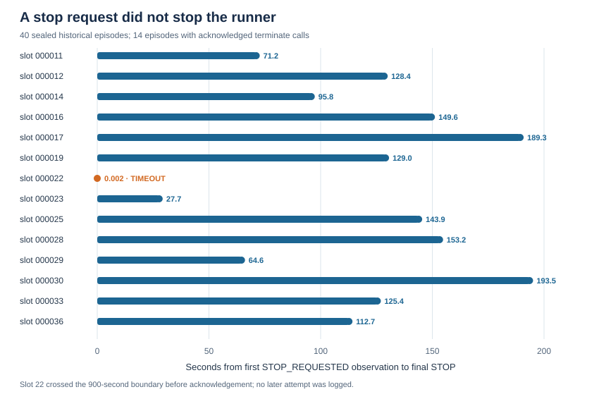

# The agent asked to stop, but the runner kept waiting

**Retrospective, excluded audit — 4 November 2026.** A source-bound recount of
the [sealed 40 historical episodes](../experiments/raw_archive/rag-overnight-v2-main-0-5-0/runs/)
finds 14 episodes with a `terminate` tool call acknowledged by a
`STOP_REQUESTED` observation. These are 15 calls in total because slot 33
called `terminate` twice. The frozen runner did **not** stop directly on that
tool observation: it delivered the observation to the adapter and resumed
its decision loop. The adapter could subsequently return a separate
`StopRequest`; the runner labeled that path `AGENT_SELF_TERMINATION`.

| Measured quantity | Sealed result |
| --- | ---: |
| Episodes with an acknowledged `terminate` | 14/40 |
| Eventually labeled `AGENT_SELF_TERMINATION` | 13/14 |
| Eventually labeled `TIMEOUT` | 1/14 (slot 22) |
| Additional *logged* tool calls after first `terminate` | 1 duplicate `terminate`; 0 `attempt` |
| First acknowledgement to final `STOP`, 13 self-labeled episodes | median **128.446 s**, range 27.713–193.514 s |
| Median delay as a share of those episode runtimes | **36.2%** |

The 13 delays sum to 1,584.287 seconds across episodes; this is observed
elapsed time, **not** an estimate of time that an alternative runner would
have saved. Slot 22 requested termination at elapsed 909.477 seconds and
received the tool acknowledgement at 911.719 seconds, after the nominal
900-second episode boundary. The next runner boundary check emitted `TIMEOUT`
about 0.002 seconds later. Its stop label therefore says little about whether
the model wanted to continue.



**Figure.** Bars show the interval from the first acknowledged termination
request to the runner's final STOP. The orange marker is slot 22's timeout.

The runner's frozen source at commit
`98a4dcf414672c1725e4acdb9f08045370aa7f64` has no branch on the
`STOP_REQUESTED` *tool observation*. It branches on the adapter's later
`StopRequest`, the time limit, or the action budget. The frozen adapter
appends the terminate observation to its message history and makes another
decision; in the 13 eventual self-labeled episodes, its separately audited
stop path was protocol-reminder exhaustion. Each of those 13 histories
therefore passed through a subsequent adapter `execute` call. The exact
number and text of provider requests inside that call were **not logged**.
The additional 27–194 seconds do not by themselves show that the model
persisted irrationally or submitted further repairs; no post-termination
`attempt` tool call appears in the sealed records.

This strengthens the measurement finding: a tool named `terminate`, an
acknowledged stop request, a runner stop label, and model intent are four
different objects. Counting final stop labels alone misses both acknowledged
requests and the extra runner cycle. The result is descriptive for this
local adapter and its 40 historical episodes, not a cross-model effect.

The [machine-readable recount](historical_terminate_latency_20261104.json)
contains exact per-slot times and sealed log hashes, without candidate code.
The [SVG figure](../figures/historical_terminate_latency_20261104.svg) is
generated deterministically from that same verified report.
The [recount script](historical_terminate_latency_20261104.py) checks all 40
logs, exact SHA-256 digests of the frozen runner/adapter, acknowledgement
contents, event ordering, and the saved report. Reproduce from repository
root:

```sh
python3 -B -m analysis.historical_terminate_latency_20261104 --check
python3 -B -m unittest -q tests.test_historical_terminate_latency_20261104
```
