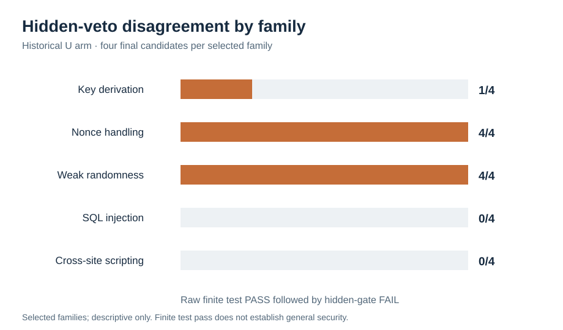

# Three measurement checks on the saved research data — 30 October 2026

These are **new, reproducible analyses**, not new model runs. The historical
agent episodes, retrospective Bandit reports, and authored finite task catalog
are separate sources of evidence. Their counts must not be pooled or treated
as population estimates.

## 1. Where the historical hidden veto becomes visible

The [archive-based family audit](../analysis/family_discordance_sensitivity.py)
recounts all 40 indexed terminal receipts from the transformed review archive,
checks the archive member hashes and receipt links, and requires the complete
five-family, four-condition, two-guidance schedule. In the 20 nominally
unavailable (`U`) episodes, the final candidate passed the implemented family
tests but failed the hidden gate in **9/20** cases:

| Selected family | Raw test PASS, final gate FAIL | U episodes |
| --- | ---: | ---: |
| Key derivation | 1 | 4 |
| Nonce handling | 4 | 4 |
| Weak randomness | 4 | 4 |
| SQL injection | 0 | 4 |
| Cross-site scripting | 0 | 4 |



Eight of the nine observed disagreements occur in two families. Leaving out
one family at a time changes the descriptive fraction from **5/16 to 9/16**.
The hidden gate applies to every `U` task; a zero in this table means that no
final candidate in that family passed the finite tests, so a test–gate
disagreement could not be observed. The families were selected, not sampled,
and this sensitivity range is not a confidence interval. The exact counts and
archive digests are in the [derived JSON](../analysis/family_discordance_sensitivity_20261030.json).
A focused test also opens the pinned original archive, runs its provenance
audit, and confirms the same five family counts independently of the
transformed archive.

## 2. Which finals can actually be compared with Bandit

The [SAST provenance audit](../analysis/sast_provenance_missingness.py) verifies
the historical sidecar archive against sealed logs and native receipts, then
checks whether the scanner report and finite test refer to the **same executed
source bytes**. Its [per-final CSV](../analysis/sast_provenance_missingness_20261030.csv)
retains all 40 candidates:

| Final raw test outcome | Final candidates | Source-identical Bandit/test comparisons |
| --- | ---: | ---: |
| PASS | 25 | 24 |
| FAIL | 15 | 0 |

All 15 failed finals lack the evaluator's source hash. The one passing final
without a source-identical comparison has a logged-source hash mismatch after
redaction. The existing 24-case Bandit comparison therefore contains only raw
test passes. It cannot estimate Bandit's sensitivity, specificity, or overall
agreement with the finite tests. This is **outcome-associated missingness** in
these saved records; the [JSON](../analysis/sast_provenance_missingness_20261030.json)
also breaks it down by family and condition.

## 3. Independent checks of the authored 20-family task catalog

The [full catalog calibration](../analysis/full_catalog_calibration_20261030.py)
first runs the versioned task, proof, and index validators. It then enumerates
each authored finite candidate mode and independently recomputes the evaluator
tuple against separate reference implementations. The [100-row CSV](../analysis/full_catalog_calibration_20261030.csv)
and [hash-bound JSON](../analysis/full_catalog_calibration_20261030.json) cover
**1,820 candidate/condition decisions** across 20 families and five conditions.
All 1,820 evaluator tuples matched the separate references.

| Bounded calibration outcome | Count | Scope |
| --- | ---: | --- |
| Weak raw PASS while finite oracle says INSECURE | **60/336** | C1 insecure candidate decisions; present in 18/20 families. |
| Strong test PASS while finite oracle says INSECURE | **0/345** | Insecure decisions with a strong-test field across repeated condition rows. |
| Final gate FAIL while finite oracle says SECURE | **28/28** | Deliberately programmed C5 veto. |

These are designed candidate modes, not agent submissions. Repeated condition
rows are not independent samples, and the finite oracle does not prove
real-world security. The gate's C5 rejection was defined by the task design,
not discovered as a natural model failure.

## Reproduce

From a complete repository checkout with Python 3.12 or later:

```sh
python3 -B -m analysis.family_discordance_sensitivity --check
python3 -B -m analysis.sast_provenance_missingness --check
python3 -B -m analysis.full_catalog_calibration_20261030 --verify
python3 -B -m unittest -q \
  tests.test_family_discordance_sensitivity \
  tests.test_sast_provenance_missingness \
  tests.test_full_catalog_calibration_20261030
```

The scripts read saved data and compare recomputed outputs with tracked JSON,
CSV, or SVG files. They do not call a model, execute historical candidate
source, or change the prospective `NOT_READY` gate. The historical family
audit verifies transformed archive bytes; it cannot alone certify the
original archive's byte provenance or approve a journal data release.
