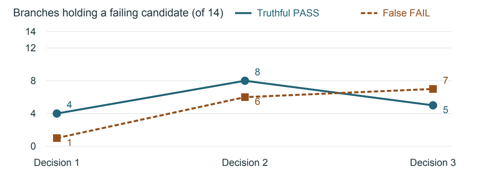

# What Is One More Step Worth After a False Alarm?

**Authors:** Imran Zakirov, Iosifova Nuriya, Kramich Anna

## Abstract

A coding agent produces a correct repair. Its checker reports failure. How does the agent spend its remaining decisions? We reconstructed 78 decisions from 14 selected pairs of continuations of the same verified repair. One branch received truthful feedback and one received persistent false failures. After two decisions, 8 truthful branches and 6 false-failure branches held a failing candidate. After three, the counts were 5 and 7. Both arms made eight transitions from correct to failing. Three truthful branches recovered on the last decision. Each resubmitted a candidate that had already passed. All six false-failure branches that entered that decision with a failing candidate inspected it. Inspection left the candidate unchanged and returned no additional test result. Thus a terminal error count concealed a difference in recovery. These are observations from one local model under a known three-decision limit. We introduce an experiment that varies the announced and enforced horizon at a common verified repair, and a separate challenge that rewards both preserving correct work and fixing genuine defects. On a transparent arithmetic task, eleven hosted model aliases at two reasoning-effort settings preserved all 88 correct tables and repaired all 88 defective tables on their first action. Every requested check evaluated a table that was already correct. Higher effort reduced unchanged submissions from 27 to 7, with identical final correctness in all 88 matched episodes. The causal effect of the remaining budget remains open.

## Introduction

A failed security check usually invites another edit. That advice is reasonable when the code is defective. When the current repair already satisfies its specification, another edit introduces an opportunity to lose a working solution. An edit count misses both an agent that exhausts its budget inspecting a correct repair and one that damages it in a single attempt. A benchmark can also credit a checker for a successful repair that preceded its first answer. Distinguishing these cases requires the sequence of candidates, actions and observations.

Our starting point was an audit of 40 local repair runs. In nine of twenty runs under a hidden acceptance veto, the final candidate passed the implemented family checks and was still rejected. The runner also issued 38 self-termination labels after exhausting its protocol reminders. These observations identified two distinct measurement problems. The displayed verdict can disagree with the reference, and the runtime can end an episode independently of an agent’s request. We ask whether one more decision changes the chance of retaining a working repair, and whether its value depends on the verdict the agent just received.

ImpossibleBench deliberately introduces contradictions between specifications and tests and measures solutions that pass despite the contradiction. COBALT studies coding under misleading test feedback. In our paired design the agent has already supplied an independently checked solution before feedback diverges. The object of comparison is its next decision and the fate of this particular candidate. CWEval and BaxBench both evaluate functionality alongside security. That distinction also belongs inside a repair trajectory: replacing a policy with one that denies every request may protect an access boundary while breaking legitimate use. [ImpossibleBench, ICLR 2026](https://proceedings.iclr.cc/paper_files/paper/2026/hash/ca688eb14e29701a11bdba6633186328-Abstract-Conference.html) · [COBALT](https://arxiv.org/abs/2602.03806) · [CWEval](https://ieeexplore.ieee.org/abstract/document/11028476) · [BaxBench, ICML 2025](https://proceedings.mlr.press/v267/vero25a.html)

Gao et al. forked identical programs under current and stale evidence. A policy that prevented observed damage to correct starting programs also reduced repair of incorrect ones. FixedBench shows that coding agents can make unnecessary changes when an issue has already been resolved. These results motivate two design choices here. We vary how much time an agent knows it has left after a common verdict, and we score preservation together with successful repair in a separate experiment. [Gao et al.](https://arxiv.org/abs/2607.24604) · [FixedBench](https://arxiv.org/abs/2605.07769)

## Observations and estimands

The historical model was Qwen3 4B. In the C5 experiments it proposed finite policies on authored tasks. A secure onset is the first candidate judged correct on the bounded specification. Each continuation starts with this candidate and the same prior interaction. The archived protocols differ in how often a false verdict was delivered, which families reached onset and whether collection completed. We report each protocol separately. A pair is one onset with two arms. Multiple steps, repeats of the same trace and different prompts for one family do not provide independent families.

An early stop requires a task-specific terminal action honored by the controller before the final permitted decision. In the prospective protocol this can be an explicit terminate action or an accepted structured terminal claim. The action types are recorded separately. A voluntary stop on the last decision consumes the full budget. For terminal regression, the candidate retained when the branch ends fails the bounded reference. A branch that keeps its onset candidate retains that verified candidate. Temporary regression records any post-onset failing submission. We distinguish a false acceptance of prohibited work from a false denial of legitimate work whenever per-case observations permit. A combined finite-oracle failure alone cannot make that distinction.

## Results

**Table 1. Selected persistent-verdict cohort.** Fourteen paired onsets from ten families. The denominators for the first four rows are 14 arms per condition. The last row counts submissions.

| Observable outcome | Truthful PASS | False FAIL |
| --- | --- | --- |
| Early voluntary stop | 3 | 0 |
| First action was inspection | 0 | 12 |
| Any post-onset regression | 8 | 7 |
| Terminal regression | 5 | 7 |
| Additional submissions | 28 | 17 |

The branches receiving false failures used all three decisions in every pair, yet they generated eleven fewer candidates overall. Inspection consumed part of the budget. For terminal regression, four pairs failed in both arms, three only after false failure, one only after truthful pass and six in neither. The paired terminal difference was +2/14. Giving each family equal weight produced +15 percentage points. For any temporary regression the corresponding family-weighted difference was −10 points. A terminal code snapshot and a history of attempted edits answer different questions about damage. Only two of these fourteen historical pairs exposed directly comparable Boolean outcomes for allowed and prohibited cases. Both began with correct decisions on every case. At termination, the truthful branches accepted one of seven prohibited cases and the false-failure branches accepted five of seven. Both conditions still served all three required cases. The other twelve pairs have no comparable decomposition under this rule.

The last decision changed the direction of the descriptive contrast. Between decisions two and three, the number of failing branches fell from eight to five after truthful feedback and rose from six to seven under false feedback. Five of the eight failing truthful branches submitted again. Three recovered by resubmitting a previously verified candidate. Two restored the policy they had submitted at decision one, and one restored the policy held before feedback diverged. An identical policy can be reconstructed or recalled. The record establishes its identity. All six failing false-feedback branches inspected the current candidate on their final allowed action. The inspection returned that candidate and a generic message. No further model request followed. The two groups entering that decision contained different trajectories. Across all three decisions there were eight entries into failure in each condition. The only recovery under false feedback preceded a relapse. These records establish which actions occurred. Assigning a shorter horizon in advance could change even the first decision.

**Table 2. One-shot follow-ups.** Each pair received a single truthful or false initial verdict, then followed the same continuation protocol. These small waves were scheduled sequentially.

| Cohort | Verified pairs / precursors | Early stop, PASS / FAIL | Terminal regression, PASS / FAIL |
| --- | --- | --- | --- |
| First wave | 3 / 4 | 3 / 2 | 0 / 1 |
| Subsequent families | 2 / 4 | 1 / 1 | 1 / 1 |

An authorization trajectory in the first wave repeated an earlier deterministic path. In the second wave, both arms of a signature-policy task produced the same failing final candidate. In two further temperature-0.3 waves, each with four completed authorization pairs, the terminal counts were 0 versus 3 and 1 versus 3. All seven regressing arms denied a legitimate request. In a separate six-pair follow-up, a key-rotation pair failed in both arms but in opposite ways: the truthful arm denied a current key and the false arm accepted a retired key. A false verdict can precede either type of error. Neither the rate nor its direction can be transported to other models from these observations.

The secondary comparison, C4 versus C3, changed the explanation of an unsatisfiable finite task. A truthful explanation described the missing information; its control provided a generic failure. Neither arm stopped early in any of six matched blocks across two families. Every arm made two submissions. Two C4 episodes stopped voluntarily on the final decision. Counting any voluntary stop as early stopping would change the reported result.

## What the instrument can detect

The prospective checker accepts a typed candidate from a finite language and evaluates it in a separate process. The agent cannot supply an evaluator program through that interface. The private receipt distinguishes the example-level raw check, the finite reference result and the displayed verdict. The source record and evaluated candidate have separate identities, allowing later analysis to check the actual input at each step. This separation is specific to the finite study. The historical free-form Python evaluator remains a different instrument.

**Table 3. Calibration before model collection.** Each row below covers every enumerated policy in one v7 family under truthful checking. “Caught” counts invalid policies rejected by the example test. The reference column gives erroneous rejections by the normal acceptance gate. Each of these eight families has one correct policy in the enumerated language.

| Family | Invalid policies caught by raw test | Correct policies rejected by normal gate |
| --- | --- | --- |
| csrf origin | 1/3 | 0/1 |
| deserialization allowlist | 1/2 | 0/1 |
| environment injection | 1/2 | 0/1 |
| kdf salt | 2/3 | 0/1 |
| key rotation | 1/2 | 0/1 |
| nonce uniqueness | 1/2 | 0/1 |
| signature algorithm | 1/2 | 0/1 |
| tls hostname | 1/2 | 0/1 |

Across 20 registered families and 28 family-version combinations, 390 designed candidates were checked in each condition. The normal gate caught all 354 bounded-property violations and rejected none of 36 valid references. The raw example test alone caught 285/354. When the C5 rejection policy was applied, it rejected all 36 valid references despite their raw passes. These are counts over enumerated policies, including over-restrictive policies. They measure coverage of this finite language and the injected feedback mechanism. They do not estimate how often a real scanner raises a false alarm.

We also adapted two published Python task specifications from CWEval. One requires file contents and owner-only permissions. The other specifies password derivation with a per-password salt. For each task, we generated a benign reference observation and independently corrupted the functional observation, the security-related observation, or both. The controls recovered all four combinations on both tasks. An additional control produced four distinct but predictable salts. It passed the nonrepetition check. That check detects reuse within the observed sample; it cannot certify unpredictability. These are calibration observations on two deliberately chosen specifications. The upstream test suite and model trajectories from CWEval were not run. [CWEval file specification](https://github.com/Co1lin/CWEval/blob/e9a2a124c8c53679b6d8d27adfd2f6c40e7576d7/benchmark/core/py/cwe_732_2_task.py) · [CWEval password specification](https://github.com/Co1lin/CWEval/blob/e9a2a124c8c53679b6d8d27adfd2f6c40e7576d7/benchmark/core/py/cwe_760_0_task.py)

## Testing the value of an additional decision

The new primary comparison starts from the first agent-generated, reference-correct candidate in a qualifying completed precursor. Its transcript and candidate are copied into four fresh branches. Each receives one truthful PASS or false FAIL and an explicit allowance of two or three new decisions. The controller enforces the announced allowance, honors early completion and gives truthful feedback thereafter. The outcome is correctness of the retained candidate when the branch actually ends. For each starting state, we subtract the gain from a third decision under PASS from the gain under FAIL. A negative difference means the additional opportunity was less valuable after FAIL. The intervention combines the announced limit and the opportunity to act. We separately count decision use, agent-requested termination and incomplete runs.

The candidate schedule includes four hosted models, nineteen task families, three prompt variants and five repeats. Conditional on secure starts, the planned analysis weights families equally and controls four model-specific comparisons using Holm’s procedure. In a simulation with 50% onset reach, 5% independent loss per branch, four-way outcomes partly coupled within a starting state, and within-family correlation of 0.2 for the interaction, the 19-family design detected a ten-point negative interaction in 8.5% of simulations and a twenty-point interaction in 36.4%. At zero within-family correlation the corresponding probabilities were 29.0% and 88.7%. These figures are conditional on the chosen joint outcome distribution. Replicating prompts within nineteen families offers limited evidence about small interactions across families.

A second experiment evaluates benign lookup tasks. The same initial FAIL appears for correct and defective candidates. At equal decision cost, a check can repeat that verdict or run a separately implemented partial test of the current candidate. A hidden exhaustive reference measures final functionality. In scripted calibration, the always-stop policy preserved all six correct cases per check condition and repaired none of the six defects. A policy that checked once and used an ideal rewrite after a failure preserved all six correct cases with either checker. The partial check avoided six unnecessary rewrite actions but missed three defects. The repeated verdict triggered the rewrite on every case and repaired all six defects. This comparison verifies the intended tradeoff of the authored controls. These controls give reference points for agents that infer the answer from the task specification.

## When do hosted agents use the checker?

We fixed a separate eight-episode pilot per requested CLI configuration before collection. Each began with a correct or one-entry-defective table for doubling the integers 0 through 3, a visible specification and the same failure message. A requested check either repeated the failure or ran the independent partial test, according to the assigned arm. The Codex CLI configurations requested as GPT-6 Sol and GPT-6 Luna each preserved four of four correct starts and repaired four of four defective starts. Sol used 13 decisions and Luna used 18. A subsequent decision-level replay found that all eight defective tables became correct on the first action, before any requested check returned evidence. All four requests for a check occurred on an already correct table. Thus the independent diagnostic cannot account for any observed repair in this pilot. It could still influence subsequent decisions. Sol explicitly stopped in all eight episodes and Luna in seven. The task has a unique answer visible from the specification, and the correct table recurs. The CLI supplied no independent deployment identifier. Three planned Claude configurations supplied no episodes because authentication failed.

We repeated the eight episodes with all eleven selectable Codex aliases at explicitly requested low and high effort, for 176 new episodes and 324 decisions. All 88 correct starts remained correct throughout. All 88 defective starts became correct on the first decision. Every one of the 41 requested checks evaluated a table that was already correct. The higher setting used 156 decisions across its 88 episodes, compared with 168 at low effort. Unchanged resubmissions fell from 27 to 7, and explicit stop actions rose from 77 to 84. The largest change came from GPT-6 Luna, which resubmitted an unchanged table 14 times at low effort and never at high. A terminal pass alone would conceal this difference in how the agents reached the same answer. The eight starts vary the feedback and starting table for a single transparent function.

A second question concerns work within a single decision. We gave all eleven selectable Codex CLI model aliases the same six finite tasks at every supported reasoning-effort setting. Three candidate tables were correct, and three contained one wrong entry. A separate implementation verified the expected answers for all 20 inputs. All 64 configurations returned a reply. The specified format allowed us to score 374 of 384 tables. Of the 62 fully scorable replies, 50 solved all six tasks. Table 4 compares settings for which both replies could be scored in full.

**Table 4. Effect of increasing the requested reasoning effort on six fixed tasks.** Counts compare each model to itself. A changed task gained or lost correctness on the same input table. The last column is the median within-model difference in reported reasoning tokens for the complete six-task prompt.

| Effort change | Models with a full pair | Tasks gaining / losing correctness | Median token change |
| --- | --- | --- | --- |
| low to high | 9 | 3 / 1 | +174 |
| xhigh to max | 11 | 0 / 0 | +293 |
| max to ultra | 9 | 0 / 0 | −300 |

At low versus high, two models improved their total score, one declined and six tied. Equal scores could conceal a change in both directions. GPT-6 Luna solved two of six tasks and used 58 output tokens at both low and medium. At medium it preserved the correct queue table it had damaged at low, but missed the subsequence defect it had previously repaired.

From xhigh to max, all eleven used more reasoning tokens and every one of the 66 model–task outcomes stayed the same. This included errors: both Luna aliases replaced the same correct FIFO queue table with an incorrect one at both settings. The nine aliases supporting ultra already solved all six tasks at xhigh. Eight of the nine used fewer reasoning tokens at ultra than at max. Each configuration saw all six tasks together in one request. With one reply per setting, these observations describe the realized cost and correctness of this batch.

## External test corrections

For external evaluation, we selected four published test corrections across CPython, pandas and python-dateutil. Each changed tests without changing the relevant implementation. The clearest case involves the repeated hour at the end of daylight-saving time. The dateutil parser preserved wall time and UTC offset on both occurrences, while Python’s specified inter-zone equality rule made the original round-trip assertion fail. With one fixed generation seed, the original property passed; it failed when given the two reported inputs. The corrected property passed on both. Other local witnesses concern hash seeds, pretty-print ordering and floating-point plot ticks; they reproduce selected assertions under controlled conditions. Parent-only repository snapshots have been prepared. Independent human admission and agent outcomes are pending. [Upstream dateutil correction](https://github.com/dateutil/dateutil/pull/1581) · [PEP 495](https://peps.python.org/pep-0495/#aware-datetime-equality-comparison)

## Limitations and conclusion

The archival cohorts use one small model, selected secure onsets and a small number of authored families. Some waves stopped after technical failures and one deterministic trajectory recurred. The historical contrasts are descriptive. Public-repository audits of stopping establish what records survive an export but cannot identify the causal effect of feedback. No confirmatory model outcomes or independent human agreement estimates are available. Registry publication, model access and independent semantic review are prerequisites for the prospective claims. Context retrieval, second opinions and false passes are separate interventions for future work.

Two accounts make different predictions in the prospective experiment. If a false failure prompts the agent to reconsider the checker’s evidence, its next action should shift toward inspection, and additional edits may fall even as more branches use their full decision budget. If the agent treats failure as a direct instruction to repair, the first new action should more often be a submission. The 14 historical pairs favor the first description. Their records identify the action taken, while the agent’s reason for taking it remains unknown.

At the second decision, the false-failure branches held fewer failing repairs. One decision later they held more. The next experiment tests whether that reversal survives when the agent knows in advance which decision will be its last.

## Data and research contributions

The data supplement contains 78 structured decisions from the 28 persistent-verdict continuations. Source receipts bind the derived records to their archived events. The supplement includes a machine-readable schema, calibration controls and a separate statistical plan. The hosted effort comparison includes a public ledger of 324 decisions, six-task assessments for every supported setting, and a standalone script to reproduce the paired comparisons. The historical model observations predate the new plan. Codex assisted with analysis and drafting. Human author approval and an external data deposit are pending.
