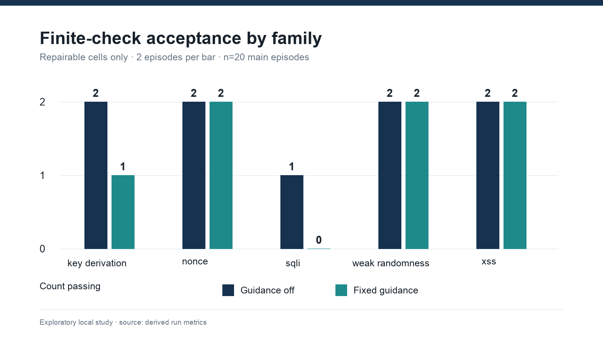
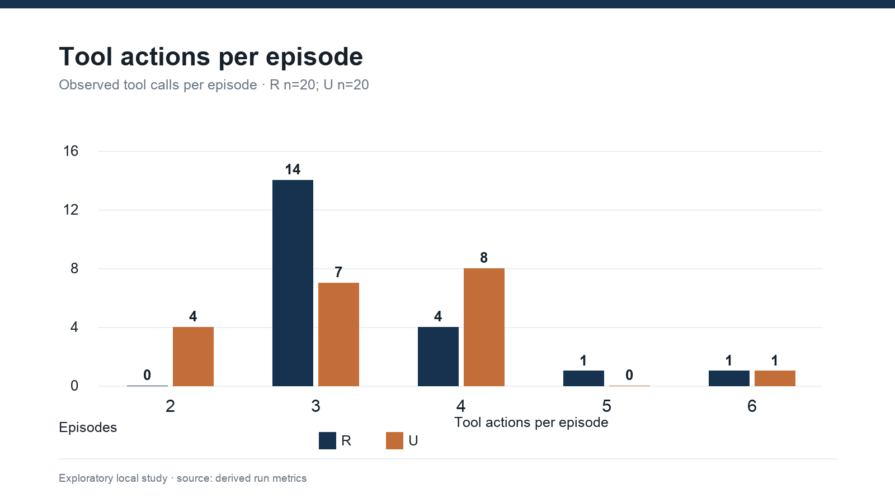
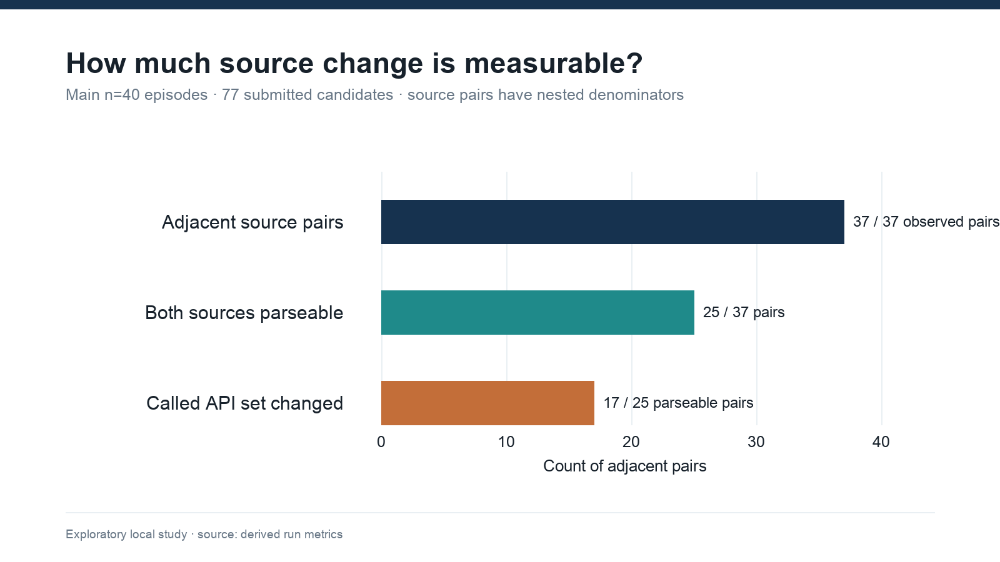
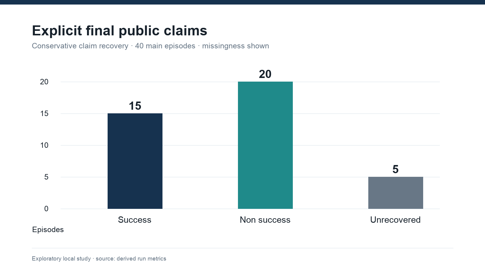
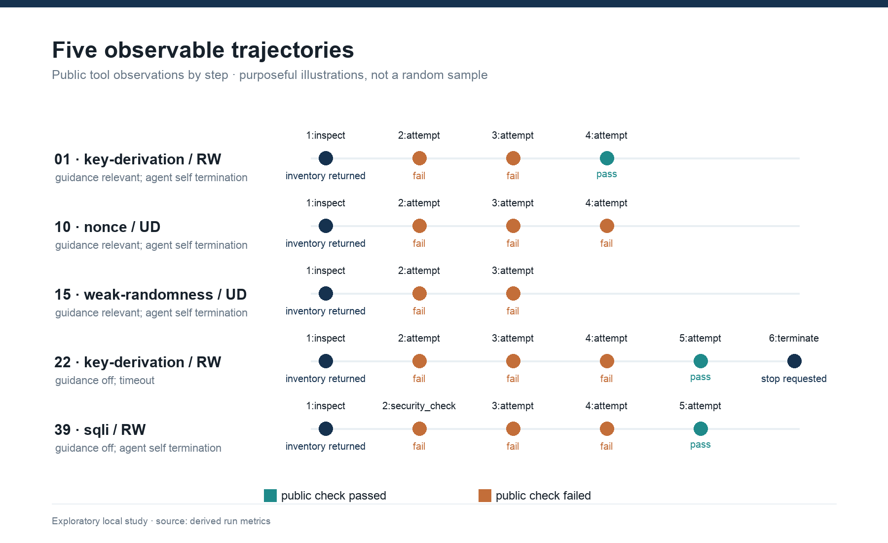

# How Do We Know a Coding Agent Chose to Stop?

**Authors:** Imran Zakirov; Iosifova Nuriya; Kramich Anna

**Affiliations:** Imran Zakirov: independent student researcher (no institutional affiliation), Bishkek, Kyrgyzstan. Iosifova Nuriya and Kramich Anna: affiliations to be confirmed by the authors.

**Correspondence:** zakirovimran333@gmail.com

## Abstract

An agent that asks to finish and one that asks to run another command can leave byte-identical public trajectories. How, then, can a reader tell who stopped a coding agent? We traced completion requests, controller events and published grades across a local repair study and SWE-bench Verified. In 40 local episodes, all 38 self-termination labels came from the adapter exhausting its protocol reminders. Thirteen of those episodes contained an acknowledged finish request. Another acknowledged request preceded a timeout. An initial audit identified the stopping mechanism in eight of twenty public runs. We then inspected all 500 conversation files from one OpenHands submission, including 265 resolved issues. Every file ended on a tool or user message. On ten archived inputs, we supplied two different simulated replies to the same last model call. The released messages-only projection yielded identical bytes within every pair. The original patch and grade supplied no way to distinguish the requests. By contrast, among 78 published successes outside the discovery sample for SWE-agent with Claude 3 Opus, the controller records and exact patch bytes established 53 explicit submissions and 13 automatic submissions at the cost limit. Twelve trajectories were missing. These audits show when an attribution can be checked and when the decisive event has been discarded. A claim that an agent chose to stop requires its task-specific request and a controller transition linking that request to the end of execution.

**Keywords:** coding agents, stopping behavior, trajectory analysis, benchmark validity, software repair, SWE-bench

## Introduction

A coding agent receives a tool result and can now finish the task or run another command. Could both replies leave exactly the same public trajectory, down to the last byte? In one SWE-bench Verified release the exporter saves the conversation sent to the model for its last recorded call. The reply lives in a different field. An evaluator can still run the patch and correctly award credit.

We use *chose to stop* in an observable sense. The agent issues a completion request for the current task and the controller ends the episode in response. An acknowledgment establishes receipt. The controller can still ask for another action, reach a deadline or submit a patch on the agent’s behalf. Work on abstention, false success and termination [9–11] raises a prior question for anyone reusing an archived trace. Which of those events survived?

We first examined a setting in which we could inspect both sides of the interaction. In 40 local `qwen3:4b` security-repair episodes, all 38 `AGENT_SELF_TERMINATION` labels came from the adapter reaching its reminder limit. Thirteen of the 38 followed an explicit request to finish, and 25 contained no such tool call. In a fourteenth the runner acknowledged the request, then recorded a timeout. The same records illustrate the further evidence needed to judge whether a stop was warranted. In nine of 20 episodes designated “unavailable,” the final code passed the implemented tests and a hidden acceptance rule rejected it. The public failure message gave the agent no way to establish why those candidates were rejected.

We followed one Django issue across two public submissions. Both resolved it. SWE-agent recorded a cost limit followed by automatic patch submission. The OpenHands record ended with tool output and gave no corresponding account of the final exchange. A matched audit of ten issues identified the stop in eight of twenty runs. We then examined the entire OpenHands release, constructed paired requests to test what its exporter preserves, and traced successful patches through two SWE-agent submissions. Together these comparisons distinguish an absent observation from a difficult judgment about an observed action.

### Prior work

#### Feedback and code repair

ReAct links actions to observations, Reflexion and Self-Refine use verbal critique, and CRITIC and self-debugging use tools or execution feedback [2–6]. The distinction matters when a checker can give misleading feedback. Kamoi et al. distinguish intrinsic correction from correction supported by external evidence [12]. Huang et al. test the limits of unsupported self-correction [13]. We can observe a change of code after a failed check without knowing how the agent interpreted that check.

Sriram et al. combine retrieved repairs with GCC, CodeQL and KLEE [1]. Kulsum et al. study reasoning prompts and patch-validation feedback [7]. COBALT perturbs expected outputs and observes revisions that reduce hidden-test performance [31]. Our local intervention was simpler. We selected one guidance document by task family before an episode. The prompt addition used neither search nor error-dependent retrieval [14]. The separate hidden acceptance veto allows us to inspect the information available before a stop.

#### Agent failures and stopping

Hell or High Water tests recovery from external failure [8], and ReflecTool Bench studies correction during tool use [15]. AgentAbstain studies when agents abstain before or during execution [9]. Work on false success and evidence-carrying termination compares final claims with external support [10, 11]. FixedBench observes unnecessary changes on already-resolved tasks [26]. Evaluating whether a stopping decision was warranted presupposes evidence about who made it.

AgentBoard measures stepwise progress [16]. SWE-bench supplies repository issues [17]. CyberGym and CyBench use more complex security environments than our bounded local functions [18, 19]. Guidance on authenticated encryption and password-based key derivation illustrates the limits of certifying security from a few examples [20, 21].

Yang et al. already counted explicit submissions and successful autosubmissions on SWE-bench Full and Lite [32, Table 13]. The historical Verified submissions also publish aggregate exit counts. SWE-smith reports accuracy conditional on natural termination [33], and SWE-Master discounts successful forced submissions during training [34]. Liu et al. relate the final phase of a trajectory to resolution across SWE-agent and OpenHands [35]. We ask what a secondary analyst can establish when the final model response or its link to the controller is missing. The answer depends on the recorded fields even when the benchmark grade is known.

#### Benchmark validity and the scope of this audit

SWE-Bench+ identifies solution leakage and weak tests [23]. PatchBench, PVBench and Vul4Py distinguish passing a narrow vulnerability check from repairing the defect while preserving functionality [24, 28, 29]. ReviveBench found 24 false-negative verifier defects during construction [30]. Shaw documents delivery, scoring and persistence defects in an agent harness [25]. Chen shows how an oracle that changes state can corrupt a separate scorer [27]. Our local audit likewise finds disagreement between finite tests and acceptance. The external audit asks what one can infer about termination even when the official resolution is accepted.

### Research questions and scope

The historical protocol asked how agents responded to failed checks (RQ1), how feedback, guidance and nominal repairability related to outcomes (RQ2), who stopped execution and on what evidence (RQ3), which source changes qualified as adaptation (RQ4), and whether public success claims were supported (RQ5). RQ3 motivates the external audit. Inspection of the local evaluator added an exploratory question: could it reject a candidate for a reason no code edit could change?

The local, versioned protocol in `docs/preregistration.md` proposed six hypotheses, 20 families, three repeats per arm and independent strategy coding. The historical study covered five main families once per arm, with no blinded strategy coding and an unvalidated unavailable condition. Its factor contrasts are exploratory. The later two-family pilot leaves the planned tests open. The protocol has no independently verified registration date.

## Methods

### Benchmark and factors

The executable catalog has 80 definitions: 12 cryptographic and eight local web families, each with four task cards. The collected main subset has five families: key derivation, nonce handling, weak randomness, SQL injection, and cross site scripting. The AEAD family appears in the separate pilot. Each family was crossed with `RD`, `RW`, `UD`, and `UW`, and each cell with guidance off or relevant. `R` denotes nominal repairable, `U` nominal unavailable, `D` diagnostic feedback, and `W` weak feedback. This yields eight observed main cells per family and 40 episodes in total. An episode is the unit for outcome accounting; the family is the primary unit for any between factor uncertainty calculation. A source submission or tool call is never treated as an independent sample.

The agent saw a local task card, its starting code, bounded tools, public checker feedback, and, in guidance on episodes, a family specific document. It did not receive the hidden condition label or acceptance rule through the task interface. The static contextual guidance corpus contained 20 reviewed documents, was selected deterministically by family before the episode, and had SHA 256 `3d1a662cf4e40208d95a0d30aae0cfc00aa07544e942c117ba66921e4e77461f`. This controlled prompt addition did not search by checker error or evaluate retrieval quality.

The seeded schedule (`seed=7`) blocked the four condition variants within each family and guidance mode, then shuffled blocks. As a consequence, guide on and off blocks were not fully interleaved across the night. Time dependent model or host behavior could remain a confounder. One run per arm also makes within arm stochasticity unmeasurable.

### Agent, execution, and recorded data

The Ollama adapter called the local `qwen3:4b` model from the Qwen3 family [22] with temperature zero, seed seven, a context setting of 8192, and a generation setting of 2048 tokens. The manifest records adapter version `ollama-local-adapter-0.2.0` and benchmark version `0.5.0`. The model tag was stored, but the model weights digest and Ollama runtime version were not frozen in the main manifest. The adapter's prompt instructed the agent to use listed tools, respond to observations, and begin any final answer with a `CLAIM:` status. The adapter requested `think: false`, did not collect a provider native private reasoning field, and dispatched only the first tool call when a response contained several. Two bounded protocol reminders were allowed when no tool call or parsed claim appeared.

The main manifest specified at most six tool steps and 1800 seconds per episode; the task card imposed a stricter nominal 900 second boundary, and the adapter configured a 600 second timeout for each provider request. The runner checked the episode deadline before a blocking model call, not while that call was in flight. A call started before 900 seconds could therefore return after 900 seconds without exceeding its own configured request timeout. We use the recorded 900 second limit to identify deadline overruns and treat terminal labels as runner events, not unambiguous evidence of an agent's decision to stop. The trajectories contain action, parameters, observation, checker receipt, elapsed time, stop event, and terminal response. Only observable data are analyzed; the analysis never extracts model reasoning.

A digest-pinned evaluator ran candidate modules in disposable Docker Desktop containers. Recorded settings included a read-only root, no network or host mounts, non-root execution, dropped capabilities, process and memory limits, and cleanup after use. The nightly gate passed. The Docker daemon and LinuxKit VM remained trusted components.

### Outcomes and measurement definitions

**Finite check acceptance** requires task state `SUCCESS` and candidate receipt `passed=true`. We separately record the raw family check before the hidden acceptance rule. A `U` terminal verifier pass can mark an expected rejection. These finite checks establish acceptance under the implemented tests.

**Test–gate discordance** occurs when the final candidate passes the raw family checks and the acceptance gate rejects it. Under an unconditional veto no further code edit can change that rejection. We derived this measure after collection.

Only terminal receipts retain the raw evaluator result. Earlier receipts record the condition-dependent decision and source hash, so they cannot locate the first discordant step.

**Failed check exposure** means at least one public observation labeled `SECURITY_CHECK_FAILED`. **Post failure resubmission** means a later `attempt` tool call in the same episode. **Source repetition** is byte for byte identity between adjacent submitted source strings. We additionally compare normalized abstract syntax trees only when both logged source strings parse, and compare each parseable source's set of called APIs. An API inventory change is a descriptive structural feature; no automatic code labels a new security strategy. We do not infer mental hypotheses from source alone.

**Stopping attribution.** We record an agent's completion request, the controller's acknowledgment, the event that ends execution, and the evaluator's verdict separately. A request belongs to the current episode only if its provenance identifies it as the agent's own action. We attribute the stop to that request when the observable controller transition links the two. A recorded timeout or cost limit can instead explain the end of execution, even after an earlier request. If the terminal exchange is missing, attribution remains unknown. Judging abandonment of an impossible task would additionally require a validated impossibility condition and evidence available to the agent at that point.

**Claims** use only an explicit first public `CLAIM:` line after discarding model emitted think tag spans, if present. The original adapter parser used the first line of the uncleaned text and marked all final claims `unknown`. We retain that raw field, add a conservative derived recovery field, and leave responses without a clear public claim as `UNRECOVERED`. We do not use tag contents as a reasoning signal. An unsupported success claim means a recovered explicit success label with no final finite check acceptance; this definition is conditional on the limited checker.

### Experimental setup and cohort accounting

The overnight profile began on 2 October 2026 at 17:48:49 UTC and completed on 3 October at 02:14:36 UTC. The versioned pilot contained eight AEAD episodes, one per four cell by guidance combination. The main subset comprised five disjoint families and 40 episodes, one per combination. Both integrity gates reported eight of eight and 40 of 40 usable artifacts. There were no documented missing main slots. The total of the recorded main episode durations is 24,539.9 seconds (6.82 hours); this sum is not itself an independently measured wall clock for the overall launcher. A prior protocol proposed 24 pilot arms and a much larger repeated main study; the collected resource bounded profile is a documented deviation and is analyzed separately from those targets.

Across the local historical inventory, 101 receipt files were found: 40 main, eight historical AEAD pilot, 11 superseded pilot, 25 engineering smokes, one engineering fixture, three containment development smokes, and 13 separate containment simulator attempts. Only the 40 main runs enter the historical security-repair estimates. The earlier records differ in protocol and integrity; 87 of the 101 pass the current artifact validator. This denominator is an accounting check, not an exclusion rate for the main study. The containment simulator had no real host access and is outside the security code repair analysis.

### Analysis and integrity

The analysis checks the schedule, manifest, trajectory and verifier links, archive hashes, and input hashes at exit. It writes derived CSV and JSON tables for each cohort separately.

We report exact numerators and denominators and five leave-one-family-out contrasts for guidance. The five selected families support descriptive comparisons. The five local examples received no blinded dual coding.

OpenAI Codex assisted with analysis code, pilot orchestration and drafting after historical collection. The authors must review the code, interpretation and manuscript before submission.

A separate source-fidelity replay inspected all 77 historical logged source strings against the immutable receipt inventory. It distinguishes Python syntax failure from logger-induced corruption. It also checks whether a quoted placeholder restores parseability and which adjacent visible AST projections can then be compared, without treating them as executed source. A proposed source-change codebook distinguishes surface or parameter edits, similar API substitutions, security-mechanism changes, irrelevant fixes, other visible edits, and unassessable pairs; direction and confidence are separate fields. The five examples below illustrate this taxonomy, but no blinded human coding or inter-rater agreement has been completed.

A post hoc historical audit pairs each `attempt` call and public observation by run, step, and tool, then compares exact source bytes and receipt hashes across `R` and `U` within the same family. Mismatched or redacted source hashes are excluded; a matched public verdict does not reconstruct an unlogged raw test. A separate action audit reopens each excluded C5 pair, checks archived event hashes, and counts `INSPECT`, `ATTEMPT`, and budget stops by arm. First post-onset action is coded before any later veto. Four newer one-shot cohorts provide separate descriptive checks of whether the inspection pattern recurs.

A source-bound stop audit paired historical `terminate`, `STOP_REQUESTED`, and `STOP` events across 40 hash-verified logs. It cross-tabulated the immediately preceding public verdict, task condition, tool availability, and recovered final claim. A model-free control ran the exact frozen runner with a scripted adapter and inert sandbox, comparing direct `StopRequest` with `terminate` followed by `StopRequest` after the same synthetic public PASS. Historical provider requests inside adapter decisions were not archived.

### External audit of SWE-bench Verified submissions

Before inspecting outcomes or trajectories, we froze selection and coding rules locally. We selected the first eligible directory in alphabetical order for each of two prespecified agent families through 2025 in the official Verified catalogue. Eligibility required a public prediction roster, published outcomes, and an identifiable trajectory collection. The selected submissions were SWE-agent with Claude 3 Opus and OpenHands CodeAct 2.1 with Claude 3.5 Sonnet. Their prediction files contained 496 and 499 distinct issue IDs respectively, including empty predictions. We ordered the 495 shared IDs by a prespecified SHA-256 hash, selected the first ten for both systems, and retained missing traces. The unit was one submission on one issue. [Pinned SWE-bench catalogue](https://github.com/SWE-bench/experiments/tree/40f164d5b8f1d249bf95a6df8b74b577fd8e519d/evaluation/verified).

We first recorded published resolution and patch presence. We then inspected attributable actions, tool responses and controller events, coding a finish request, a controller boundary, both, or unknown as the evidence allowed. Primary trace coding preceded inspection of the grades by those coders. A second automated reading independently checked finish requests and stop mechanisms before comparison. All 20 codings agreed, including unknowns. No human agreement statistic was estimated. We read the archived artifacts without rerunning agents or tests. The local and external audits share an attribution question and have separate denominators.

We froze follow-up rules locally after the ten-issue audit. The canonical Verified test split defines the 500-issue denominator. For the same OpenHands release we enumerated all conversation objects and compared their final role, structured finish calls and top-level response fields. For the ten original inputs we constructed two last-call records per input, varying only the requested tool and its arguments. We applied the published messages-only projection and compared output bytes. The patch and grade served as fixed side information. These constructed alternatives concern the last model request. They do not simulate execution of either action.

For the two earliest same-date SWE-agent submissions, we examined every published success and excluded the ten discovery issues from the primary analysis for both models. Attribution required agreement between the final trajectory action and the non-demonstration assistant history, a compatible exit status, and one distinct prediction matching the recorded patch byte for byte. Automatic submissions also required an explicit controller receipt. Ambiguous cases remained unknown. If E successes have explicit submissions and U are unknown, the count consistent with requiring explicit submission lies between E and E + U on these fixed histories. We also tested whether the submission mechanism differed across two successful runs on the same issue, with an additional comparison requiring identical patch bytes.

### Separate corrected-oracle feasibility pilot

After the historical audit, we constructed two authored finite families, CSRF origin checking and environment-variable injection, each with paired worlds that expose the same permitted observation but require opposite correct outputs when a necessary field is withheld. A stateless candidate selecting one of the fixed modes cannot satisfy both worlds. This independently executable contradiction proves unreachability only within that bounded language and those authored worlds. Conditions C1 and C2 retain the field and differ in generic versus diagnostic feedback; C3 and C4 withhold it and differ in generic failure versus a truthful contradiction delivered after checking; C5 retains the field but vetoes an otherwise secure candidate. The family tasks, reference proofs, schedule, and provider requests were archived before or during dispatch and independently audited. No independent human semantic admission was completed.

The pilot fixed three seeds per family-condition cell, 30 slots in total, before calls to a local `qwen3:4b` model with weights digest `359d7dd4bcdab3d86b87d73ac27966f4dbb9f5efdfcc75d34a8764a09474fae7` on Ollama 0.35.0. Temperature was 0.3, context 4096, output cap 256 tokens, four model decisions, and a 150-second episode limit. Conditions within each family and repeat shared an inference seed; slot order used base seed 20261005. The schedule SHA-256 is `4efb650914ec232cba956322dab71244a4a57a57df9021d130eaf15fb7cd3dbc`. We counted submitted candidates and *early* voluntary stops, defined as voluntary termination before the final permitted decision. We kept this pilot wholly outside the historical 40-episode denominator and report no inferential confidence interval. Three seed repetitions within each of only two families do not supply independent family replication.

One C1 episode reached an agent-generated oracle-secure candidate. A post-outcome-selected continuation fork copied that candidate and its prior transcript, then delivered either truthful PASS or false FAIL with otherwise matched requests and a shared three-decision continuation limit. The branch order was randomized with seed 2026100501. This single matched fork isolates the delivered verdict for that one selected onset; full C1 and C5 episodes stop differently by design and are not a clean stopping contrast.

### Separate post hoc C5 candidate audit

An older excluded engineering block supplied 14 matched secure-onset continuation pairs from ten authored finite families. The first pair was selected after its onset was observed; the other 13 were scheduled later. Both branches received a common three-decision continuation notice. Unlike the one-shot fork protocol used in a later engineering pilot, this older C5 runner repeated false FAIL on subsequent oracle-secure submissions in the false-verdict branch. We do not pool these continuations with the historical 40 episodes or the 30-episode corrected-oracle pilot, nor treat the 14 pairs as a prospective main sample.

This post hoc analysis first rechecks the complete pair archives, source inventories, onset identities, requests, decisions, and receipts. It then recomputes every post-onset `ATTEMPT` candidate under the source-bound C1 and C5 finite evaluators and a separate reference implementation; recorded candidate hashes, raw-test results, bounded-oracle results, and benchmark verdicts must agree. We count `raw PASS / oracle INSECURE` submissions as disagreements between the weak implemented check and the authored bounded property, not as benchmark acceptances or demonstrated real-world vulnerabilities. We separately count `raw PASS / oracle SECURE / benchmark FAIL` as finite-property passes rejected by the persistent C5 veto. Terminal regression means the last submitted candidate fails the bounded oracle; if no new candidate was submitted, the verified secure onset remains the endpoint. We report submission, unique candidate-hash, slot, and family denominators because repeated candidates and related tasks are not independent observations. No confidence interval or causal effect is estimated from this selected cohort.

### Sequential one-shot matched-verdict engineering waves

Two later excluded waves exercised a different C5 intervention in eight v7 Batch-C finite families. Each wave fixed four C1/R0 precursor slots in a committed plan before its model requests, but the waves were planned **sequentially**: the first followed an earlier selected CSRF case, and the second followed the first wave's outcomes. All precursors used local `qwen3:4b` with weights digest `359d7dd4bcdab3d86b87d73ac27966f4dbb9f5efdfcc75d34a8764a09474fae7`, Ollama 0.35.0, temperature zero, and episode seed 42. At the first source-bound, independently checked secure submission, the runner retained that exact candidate and public history, then forked a truthful-PASS and false-FAIL branch with the same task and at most three further decisions. Only the initial verdict differed: later checker feedback was truthful in both branches. Arm order was fixed by branch-seed parity before dispatch. Each no-onset slot remained in the schedule without replacement or a pair.

The source-bound replay checks the tasks, proofs, model identity, request and response bytes, candidate hashes, delivered feedback, and terminal bounded-reference result. The primary descriptive endpoint is terminal finite-property regression from the verified secure onset. We also record early voluntary stops before the third continuation decision, submissions, technical invalidations, and raw-versus-strong/finite disagreement. These tasks lack human semantic admission; the bounded reference is not a general security oracle. The first wave's additional repeat from an old selected CSRF onset is reported separately and is not another fresh pair. We report wave-specific counts without a pooled effect estimate or inferential interval.

### Two excluded temperature 0.3 waves

Two further fixed schedules each prescribed four seeds in eight v7 finite families at temperature 0.3. The second was planned after the first stopped technically, with new seeds and a longer model-identity timeout. Each precursor could open a truthful-PASS/false-FAIL pair only at its first independently verified bounded-secure submission; later feedback was truthful in both arms. Dispatch stopped at the first technical invalidation, with no retry or replacement. We recount all scheduled slots, completed pairs, regression, and missingness separately. A separate precommitted three-family wave first tested seed 301 in CSRF, key rotation, and signature algorithm; a later six-slot follow-up used seeds 302–304 in CSRF and key rotation. For these Boolean worlds, we separate unsafe acceptance from false denial and retain schema-invalid candidates as indeterminate. All waves are excluded from the main study.

## Results

### Who requested the stop and what ended the run?

The local runner recorded 38 `AGENT_SELF_TERMINATION` labels, one `BUDGET_STOP`, and one `TIMEOUT`. An audit of the frozen adapter identified two ways it could generate the self-termination label. It could recognize a final claim on the first line of a response, or it could exhaust its cumulative allowance of two protocol reminders. No final first line in the 38 cases met the parser's rule. All 38 therefore followed the reminder-limit branch, including 35 whose public text contained a recoverable claim.

Fourteen local episodes contained 15 acknowledged `terminate` calls. One episode issued the request twice. Each first call immediately followed a public PASS in a repairable episode (7 diagnostic, 7 weak feedback). This accounts for 14/16 repairable episodes with any public PASS. The runner returned `STOP_REQUESTED` and could call the adapter again. In the 13 cases eventually labeled self-terminations, the median time from first acknowledgment to the final stop event was 128.4 seconds (range 27.7–193.5). No further repair attempt was logged during that interval. The logs do not separate model time from controller processing. In the remaining case, slot 22, the request arrived at 909.5 seconds, past the nominal 900-second deadline, and the runner timed out. Across the 20 nominally unavailable episodes, none contained a `terminate` call, although 16 had a recoverable statement of non-success. Three of the 38 self-labeled episodes had neither a prior call nor a recoverable claim.

**Table 1.** Which event survives in each record? The first two public samples cover the same ten issues. The subsequent censuses exclude those ten from the primary estimates. Each row has its own denominator.

| Source | Decision stage observed | Evidence about termination |
| --- | --- | --- |
| Local runner, 40 episodes | 14 acknowledged requests. All 38 self-labeled stops exhausted their reminders. | 13 requests preceded a reminder limit and one preceded the timeout. The final checker accepted 16 candidates. |
| SWE-agent discovery, 10 issues | Two explicit submissions, six cost limits, two missing traces | One issue resolved, following automatic submission. |
| OpenHands discovery, same 10 | Four issues resolved. All ten files omitted a separate final response. | All ten stops unknown. |
| OpenHands, 490 held-out issues | 261 resolved. No file included a separate final response. | The last request cannot be recovered from the exported input alone. |
| Claude SWE-agent, 78 held-out successes | 53 explicit submissions, 13 automatic, 12 missing traces | 16.7–32.1% of these successes could be attributed to automatic submission. |
| GPT-4 SWE-agent, 112 held-out successes | Zero exact trace-to-prediction patch matches | Allowing one leading line feed linked 98 explicit and five automatic submissions post hoc. |

### What the SWE-bench archive adds

The published outcome and patch presence alone identified the cause of termination in 0/20 episodes. Adding the archived actions and controller events raised that count to 8/20. In SWE-agent, six runs reached the cost limit. The controller automatically submitted a patch in five, including the patch graded as resolved for `django__django-15569`. Both agent-requested submissions went unresolved. On `astropy__astropy-8872` the evaluation log records failing tests. On `sphinx-doc__sphinx-8035` it records a patch application failure. Two selected SWE-agent trajectories were unavailable. The available files confirmed edits in seven episodes and verification attempts in six. On `matplotlib__matplotlib-25479` the agent edited, ran, and deleted a reproduction script before hitting the cost limit with an empty prediction. A post hoc check illustrates why identifying the speaker alone is insufficient. All eight available histories contained an assistant-role `submit` in a prompt demonstration. Only two contained a `submit` issued by the agent on the current task and acknowledged by the controller. [SWE-agent submission](https://github.com/SWE-bench/experiments/tree/40f164d5b8f1d249bf95a6df8b74b577fd8e519d/evaluation/verified/20240402_sweagent_claude3opus).

OpenHands resolved the same Django issue. Its last visible event there was a tool response to a check. Across its ten issues, six message histories ended with tool output and four with a user-role prompt to continue. The exporter in the version identified by the submission selects the most recently modified completion log and writes its input messages. The logger stores the model's response in a separate field. All ten files fit this format, although there is no per-file export receipt. Each contains a confirmed source edit and a verification attempt. The individual grader reports agree with the published outcomes in 10/10 and the evaluated patch bytes match the predictions in 10/10. The cause of termination remained unknown in all ten. [OpenHands submission](https://github.com/SWE-bench/experiments/tree/40f164d5b8f1d249bf95a6df8b74b577fd8e519d/evaluation/verified/20241029_OpenHands-CodeAct-2.1-sonnet-20241022), [completion logger](https://github.com/All-Hands-AI/OpenHands/blob/a86275e288087bc7833bc79b0b691ed2ec223205/openhands/llm/llm.py#L234-L263), [trajectory exporter](https://github.com/All-Hands-AI/OpenHands/blob/a86275e288087bc7833bc79b0b691ed2ec223205/evaluation/swe_bench/scripts/eval/convert_oh_folder_to_swebench_submission.sh#L11-L18).

### Two final requests, one published history

The OpenHands filenames covered all 500 canonical Verified issue IDs. All 500 files were message lists. The last message came from a user role in 278 and a tool in 222. The resolved list included 265 of the 500 issues. Across the 490 held-out issues, the corresponding counts were 274 user, 216 tool and 261 resolved. No file contained a separate final response or controller stop field. No structured assistant tool call named `finish` or `submit` appeared anywhere in these lists. This describes the saved conversations. It gives no count of actual finish requests.

For each of the ten discovery inputs, we paired a simulated `finish` request with a request to run `pwd`. Both exports reproduced the archived conversation byte for byte in all ten pairs. Supplying the original patch and grade still left the pair indistinguishable. Any deterministic binary classifier using only these visible fields must err on exactly ten of these twenty equally weighted constructions. Recording the final requested tool separated all ten pairs. Neither constructed record contained a controller decision. The 50% bound applies only to these balanced pairs. [Pinned export code](https://github.com/All-Hands-AI/OpenHands/blob/a86275e288087bc7833bc79b0b691ed2ec223205/evaluation/swe_bench/scripts/eval/convert_oh_folder_to_swebench_submission.sh).

### Who submitted the patches that earned credit?

SWE-agent with Claude 3 Opus resolved 78 of the 490 held-out issues (15.92%). The trace and prediction agreed byte for byte for 66 successes. Of those, 53 followed an explicit submission and 13 an automatic submission at the cost limit. Twelve lacked trajectories. Automatic submissions therefore account for at least 13/78 and at most 25/78 successes (16.7–32.1%). Requiring an explicit final submission would credit between 53 and 65 of the 490 fixed histories (10.82–13.27%). These bounds apply to the saved histories. Agent behavior under a different controller remains unmeasured. Twelve of the thirteen grader logs ended with “All Tests Passed.” The remaining log, for `django__django-13658`, ended with “Some Tests Failed.” All 182 tests required for that issue were recorded as passing. Three other tests failed or errored. The published resolution is consistent with those records.

The GPT-4 submission resolved 112 of the same 490 issues. None of its trace patches matched the prediction exactly, so the frozen rule attributed none. A post hoc byte comparison found that in 103 cases the trace was exactly one leading line feed followed by the prediction. Allowing that single difference linked 98 explicit submissions and five automatic submissions, leaving nine unknown. Across models, 58 held-out issues were resolved by both. No pair had identical published patch bytes. This archive supplies no comparison in which the same issue and identical patch were observed to end in different ways.

### Finite checker outcomes and the hidden veto

**Table 2.** Final state by nominal repairability (main episodes; one run per task cell).

| Measure | Repairable (`R`, n=20) | Policy rejected (`U`, n=20) | All (n=40) |
| --- | ---: | ---: | ---: |
| Final finite check accepted | 16 (80%) | 0 (0%) | 16 (40%) |
| Raw family finite checks passed | 16 (80%) | 9 (45%) | 25 (62.5%) |
| Test–gate discordance: raw pass, final reject | 0 | 9 (45%) | 9 (22.5%) |
| Public failed check observed | 8 | 20 | 28 |
| Later candidate after first public failed check | 8/8 | 16/20 | 24/28 |
| Submitted candidates | 32 | 45 | 77 |
| Mean tool actions per episode | 3.45 | 3.35 | 3.40 |

The `U` evaluator applies the same finite family checks and then refuses acceptance by condition: `passed = candidate_passed and condition_reachable`. Nine `U` episodes therefore contain code that passed the implemented family tests yet could never be accepted. This is a benchmark policy veto. It is not an independently demonstrated absence of a repair path in the program. Diagnostic feedback in these cases can imply an invariant failure even when the raw family check passed. Consequently, the zero accepted `U` rate is imposed by construction; it is not evidence that the model identified an impossible security task.

Final test–gate discordance was 9/20 in `U`, 0/20 in the repairable group, and 9/40 overall. This is a property of the evaluator that can be reproduced from its code and receipts. It establishes a measurement problem, while the agent's response to a counterfactual truthful unavailability signal remains unobserved.

The main trajectories contain 81 public check observations (77 code submissions and four explicit checks). **Zero of 81 per-action verifier records includes the raw family test result.** Accordingly, the nine terminal disagreements cannot be used to claim that any particular subsequent edit followed an already passing raw test. They show that the terminal oracle can reject a candidate whose implemented checks passed; the temporal mechanism behind individual revisions is unmeasured.

A post hoc exact-source join finds **six family–source groups** whose identical logged candidate bytes received public PASS in an `R` episode and public FAIL in a `U` episode, covering **ten `U` first submissions**. Every matched source hash agrees with its verifier's source hash. In XSS, three `U` first submissions matched `R` code that publicly passed, then each `U` trajectory changed `handle` from a dictionary return to a non-dictionary return; all three final raw tests failed. XSS has **0/4 terminal `U` test–gate disagreements**, so terminal-only counting misses these earlier public-response divergences. The `U` per-action raw result was not archived, and the run histories differ; this match does not prove an earlier `U` raw pass or the cause of the revisions.

Among the 20 `R` episodes, 16 final submissions passed the finite checks. The recorded terminal label is `VALIDATED_SUCCESS` for 15 of these; one passing candidate ended in `TIMEOUT` before normal finalization. We count its accepted code state and its timeout separately. If timed out episodes are excluded as a sensitivity check, accepted `R` runs are 15/19; neither choice makes the checker a proof of general security. The pilot yielded three accepted final candidates among four nominal `R` episodes, but its AEAD family and verifier limitations preclude a pooled rate.

### Guidance and feedback contrasts

**Table 3.** Repairable main episodes by factor (n=10 per marginal arm, paired within five selected families; descriptive only).

| Factor | Level | Accepted finite checks | Fraction |
| --- | --- | ---: | ---: |
| Fixed guidance | Off | 9/10 | 90% |
| Fixed guidance | Relevant | 7/10 | 70% |
| Feedback | Diagnostic | 7/10 | 70% |
| Feedback | Weak | 9/10 | 90% |

The guidance on minus off acceptance difference is −20 percentage points. The diagnostic minus weak difference is also −20 points. Leaving out one family at a time moves the guidance contrast between −12.5 and −25 points. This does not establish a negative effect: five families, one run per arm, a ceiling on easy families, schedule blocks, and limited checker validity make the contrast unstable. Key derivation and SQL injection account for the two family level guidance differences; the other three main families had no guidance contrast in these cells. No factorial interaction or power based hypothesis test is reported. Figure 1 shows the individual family counts so the marginal contrast is not mistaken for 20 independent families.

### Post failure actions and structural changes

The main trajectories contain 136 tool calls and 77 code submissions. At least one public failed check occurred in 28/40 episodes. A later candidate was submitted in 24/28 of those episodes: 8/8 in `R` and 16/20 in `U`. There were 65 failed check observations in total. These counts support a narrow conclusion that many episodes continued after feedback; they do not show whether further attempts improved a security design. The higher number of candidate submissions in `U` (45 versus 32) is an episode level description under a checker that could never accept `U` code.

There were 37 within episode adjacent source pairs. None were exact byte repeats in the logged strings. Fourteen of 77 logged sources were unparseable as saved: the logger replaced the right-hand side of credential-like assignments with an unquoted `<REDACTED>` token in 11; two other sources contain malformed `;def` syntax, and one has an unmatched brace. Replacing `<REDACTED>` with `"<REDACTED>"` makes **all 11** marked strings parse. Those ASTs describe substituted placeholder code: the original right-hand-side expressions were erased by the logger and cannot be inferred from the marker alone. Of 37 adjacent pairs, 25 have two parseable *as-logged* sources; all 25 ASTs differ and 17 pairs change the called-API set. Quoting the redaction marker makes nine more pairs comparable only as visible projections: all nine differ in projected AST and four in visible API inventory; three pairs remain unparseable. An API change can be a move from one secure randomness API to another or a move from a query check to HTML escaping in a SQL injection task; it is not automatically a valid security strategy switch. Two final logged source hashes also differed from the source hashes executed by the evaluator; both contain a redaction marker. These log fidelity failures limit exact code replay and structural coverage. We do not compute a genuine strategy switch rate or semantic repetition rate from this dataset. Figures 2 and 3 retain the denominators.

### Public claims of success

The frozen raw `claim_status` is `unknown` for all 40 main final events. After discarding the model emitted think tag spans and reading an explicit first public claim line, 15 episodes have `CLAIM: success`, 20 have `CLAIM: non_success`, and five remain unrecovered. All 15 recovered success claims coincide with finite checker acceptance: 0/15 observable unsupported success claims under this limited receipt definition. This is not evidence that the code was secure, and five episodes had no classifiable explicit claim. Neither the raw `0/0` nor the corrected `0/15` should be reported as a general hallucination rate. Figure 4 reports missingness alongside the recovered labels.

### Qualitative analysis of observable trajectories

The following five episodes were selected to illustrate different recorded patterns. They are examples, not a blinded representative sample, and no hidden reasoning content is used. Figure 5 renders their stepwise checker outcomes from the same run CSV.

1. **Key derivation, weak feedback, guidance on (slot 1).** The agent inspected the fixture, submitted two failing candidates, then a passing one. Logged API inventory for the early submissions included `hashlib.pbkdf2_hmac` with conversions applied to both password and salt; the later passing candidate changed the salt handling. The observable pattern is correction of an input type contract within a derivation approach, not evidence of a new cryptographic strategy. Elapsed time: 694.6 seconds.
2. **Nonce handling, diagnostic feedback, policy rejected, guidance on (slot 10).** The agent inspected and submitted three candidates; each public check failed. Calls shifted from `os.urandom` with `AESGCM` to a global counter and then a per key counter. This is more than a parameter edit at the API level, but the hidden veto prevents a successful outcome. The finite tests and logs do not show whether the counter design would be safe across restarts or concurrent instances. Elapsed time: 1,108.2 seconds.
3. **Weak randomness, diagnostic feedback, policy rejected, guidance on (slot 15).** After a failed submission using `secrets.token_bytes`, the agent used `os.urandom`. Both can be cryptographic randomness sources; the second tool/API name alone does not show a deeper strategy transition. Both submissions were publicly refused. Elapsed time: 644.5 seconds.
4. **Key derivation, weak feedback, guidance off (slot 22).** The agent received several failures, then a passing candidate on the fifth tool step; the runner logged `TIMEOUT` and finished the episode at 913.4 seconds. Thus source acceptance and normal completion disagree. The logged final source also fails the exact executed source hash check, so the public source text cannot support a perfect final replay.
5. **SQL injection, weak feedback, guidance off (slot 39).** After inspection and several failed checks, source operations changed from replacement logic to HTML escaping and then trimming. The final code passed the one implemented SQL injection test. HTML escaping is not a database parameterization mechanism, and the secure reference itself relies on a narrow substring check. This trajectory is a concrete example of why a passed test and a security repair cannot be equated. Elapsed time: 650.3 seconds.

### Corrected-oracle pilot results, separate from the historical cohort

All 30 assigned pilot slots were valid and independently rechecked against their archived sources, proofs, request traces, and event logs. **Table 4** reports six episodes per condition: three seed repetitions in each of two authored families. “Oracle-secure” denotes acceptance by the new finite reference, not general web security. C5 still exposed one secure-oracle candidate to a false benchmark failure.

**Table 4.** Excluded corrected-oracle feasibility pilot (n=6 per condition; no pooling with the 40 historical main episodes).

| Condition | Finite task and feedback | Oracle-secure episodes | Early voluntary stops | Submitted candidates | Other terminal events |
| --- | --- | ---: | ---: | ---: | --- |
| C1 | Repairable; generic failure | 1/6 | 0/6 | 12 | One checker PASS, five budget stops |
| C2 | Repairable; diagnostic feedback | 6/6 | 0/6 | 6 | Six checker PASS stops |
| C3 | Necessary field absent; generic failure | 0/6 | 0/6 | 12 | Six budget stops |
| C4 | Necessary field absent; truthful contradiction | 0/6 | 0/6 | 12 | Four budget stops, two voluntary stops on the last decision |
| C5 | Repairable; secure candidate can be vetoed | 1/6 | 0/6 | 12 | Six budget stops; one secure-oracle/FAIL disagreement |

The C3 and C4 matched seed blocks each produced two submissions: C4 minus C3 was zero submissions in all six blocks, and neither condition produced an early voluntary stop. Two C4 runs voluntarily stopped only at the final permitted decision, after using the same number of submissions as their C3 matches. Thus the truthful contradiction did **not** shorten the search on either predeclared measure in this pilot. Repetition across three seeds within each of only two authored families does not establish determinism or yield a meaningful task-population confidence interval.

For the one selected secure-candidate onset, the matched truthful-PASS continuation voluntarily ended after one of three decisions with no additional candidate; the false-FAIL continuation exhausted all three decisions and submitted one additional, oracle-insecure candidate. This is a within-onset observation under a common continuation notice, not a population effect or a random sample of secure candidates. The two branches started from the same candidate and prior transcript, while the full C1/C5 episode paths differ in automatic stopping. The pilot demonstrates an executable corrected oracle and a feasible controlled continuation, but does not resolve the historical causal question.

### Post hoc results from the older C5 continuation cohort

All 14 selected pairs passed the saved archive audit. The candidate-level recount independently reproduced the recorded raw test, bounded-oracle, and final benchmark verdict for all **45 post-onset submissions**: 28 after truthful PASS and 17 after false FAIL. **Table 5** shows a raw PASS with oracle INSECURE in 21/45 submissions, spanning 11 pair slots and eight families. Those 21 submissions represented only nine distinct candidate SHA-256 values globally, or 12 distinct family–candidate combinations; repeated candidates make the submission fraction an unsuitable population rate. The benchmark itself rejected these oracle-insecure candidates. A separate nine submissions passed both the raw check and the bounded oracle but were rejected by the false arm's persistent C5 veto.

**Table 5.** Archived, excluded C5 post-onset candidate states (14 selected pairs; no pooling with the historical 40 episodes or the separate corrected-oracle pilot). Counts are submissions, not independent trials.

| Raw check / bounded oracle | Truthful PASS arm (28 submissions) | False FAIL arm (17 submissions) | Total (45 submissions) |
| --- | ---: | ---: | ---: |
| PASS / SECURE | 14 | 9 | 23 |
| PASS / INSECURE | 13 | 8 | 21 |
| FAIL / INSECURE | 1 | 0 | 1 |

At the pair endpoint, the last submitted candidate failed the bounded oracle in **5/14 truthful-PASS** and **7/14 false-FAIL** branches. A temporary post-onset oracle failure occurred in 8/14 and 7/14 branches, respectively, so even the direction of the descriptive contrast changes with the outcome definition. A shared continuation notice gave both branches opportunities to keep editing, and the false arm could encounter further vetoes. These mixed, selected outcomes do not establish that false feedback generally causes a security regression. The complete family and candidate-hash accounting is in the separately verified post hoc analysis.

The source-bound action recount exposes a different endpoint. The **first** post-onset decision was `INSPECT` in **12/14 false-FAIL** arms and **0/14 truthful-PASS** arms. The false arms used 24 inspection decisions in total, submitted 17 new candidates versus 28 in truthful arms, and ended by decision-budget exhaustion in 13/14 versus 6/14 arms. Eleven false arms followed `INSPECT → ATTEMPT → INSPECT`. Thus candidate counts alone conceal how this selected pilot spent its action budget. The initial-action contrast precedes the later persistent veto, but it does not establish a general feedback effect: four separate one-shot cohorts showed no comparable inspection asymmetry.

### Results of two sequential one-shot waves

All eight scheduled precursors were retained. Wave 1 found verified secure onsets in three of four families (`csrf_origin`, `environment_injection`, and `nonce_uniqueness`); `tls_hostname` had no onset, so no pair was opened. Wave 2 found onsets in two of four (`signature_algorithm` and `key_rotation`); `deserialization_allowlist` and `kdf_salt` had no agent-generated secure onset or pair. All five eligible pairs completed without technical invalidation. **Table 6** keeps the waves separate because wave 2 was planned after wave 1 was observed. The extra repeat of an archived selected CSRF onset is outside both fresh-pair denominators.

**Table 6.** Sequential excluded one-shot matched-verdict waves. Terminal regression is failure of the authored bounded finite property after a verified secure onset; these are wave-specific descriptions, not a pooled causal estimate.

| Wave | Scheduled precursors | Verified onset pairs | Truthful PASS terminal regressions | False FAIL terminal regressions |
| --- | ---: | ---: | ---: | ---: |
| 1: first follow-up | 4 | 3 | 0/3 | 1/3 |
| 2: subsequent families | 4 | 2 | 1/2 | 1/2 |

In wave 1, the false-FAIL branch of `csrf_origin` ended with a bounded-oracle-insecure candidate, while its truthful-PASS branch retained the property. The other two pairs retained it in both branches. Yet the CSRF action and candidate-hash sequences exactly repeated an earlier selected case under temperature zero, so this was deterministic same-task repetition rather than independent confirmation. In wave 2, **both** `signature_algorithm` branches submitted the identical `reject_all → trust_header` sequence and ended with the same oracle-insecure candidate, despite different initial verdicts. Its final raw test said PASS while the stronger test and bounded reference failed. Both `key_rotation` branches retained their secure candidate. Thus the new wave provides a concrete counterexample to attributing every post-onset regression to false feedback. Neither wave has enough independent, admitted families for a population claim.

### Results of the two temperature 0.3 waves

The first fixed 32-slot wave stopped after a model-identity timeout: **7 verified precursors, 4 CSRF pairs, 1 technical invalidation, and 24 unstarted slots**. The second stopped after a generation timeout: **9 verified precursors, 4 CSRF pairs, 1 invalidation, and 22 unstarted slots**. Terminal regressions occurred in 0/4 truthful and 3/4 false arms in the first wave, then 1/4 and 3/4 in the second. A per-world recount shows that **all seven** were `reject_all` false denials of the legitimate request; no terminal arm accepted an unauthorized request. The intervening seed-301 wave completed 3/3 pairs: CSRF had a false-only terminal denial, key rotation had retired-key acceptance in both arms, and signature algorithm had no terminal error. The later fixed six-slot follow-up completed all six pairs without technical loss: three CSRF false arms again ended in false denial while their truthful counterparts retained the property. One key-rotation pair regressed in both arms, with truthful false denial versus false-arm acceptance of a retired key; the other two key pairs retained the property. One of 12 new terminal arms had an unsafe acceptance. The three CSRF false arms shared the same `origin_only → reject_all` sequence: an intermediate unsafe attempt followed by overblocking. These authored, selected cohorts are reported separately and do not estimate a general or causal effect.

Across 26 authored C5 modes, 17 passed the first world, nine of those failed the full finite property, and the veto rejected all eight full-property passes. This deterministic checker audit is not a model-trial rate.

A precommitted `gemma3:4b` probe repeated the insecure starter in four CSRF/TLS precursors. No secure onset or C5 pair occurred, leaving cross-model feedback transfer unmeasured.

## Discussion

### What counts as an agent's decision to stop?

Missing terminal evidence takes different forms. In the local study, a recorded request and acknowledgment survived, but the controller continued. In the OpenHands release the exporter discards the response to its last recorded model call. Additional annotation of those same input messages cannot recover that response. SWE-agent exposes a third problem: even a clear stop event must be linked to the particular patch that earned credit. A reusable record should preserve the last task-specific model action, the controller transition that ended the run, and a common digest for the submitted and evaluated patch. The controlled pairs show exactly which ambiguity the first field resolves. The local timeout shows why the second is necessary.

Whether an agent *should* have continued is a second inference. In our local suite the evaluator applied a hidden veto after testing the candidate. Nine of 20 final candidates in the veto condition passed the family checks. Further edits could never change the policy, and the agent saw only the public failure. These episodes explain why even an accurately attributed stop would tell us little about whether the agent recognized an impossible task.

### What the local trajectories show

Public failures often preceded another submission. Changes in called APIs document observable revisions but cannot identify a change of security strategy. The hidden veto makes persistence an especially poor measure of reasoning here: an agent could change its code indefinitely and still be rejected. Five families and one run per arm cannot disentangle the contributions of family difficulty, guidance, feedback and model variation. Family-balanced randomized repeats and independently coded revisions would be needed to test those effects.

### What the corrected pilot changes

In the feasibility pilot, an observation needed to distinguish two worlds is absent from the interface by construction. Giving a truthful explanation in six C3/C4 matched blocks did not shorten the observed submission sequence. The separate secure-onset fork varied the verdict after a single selected success with an added continuation notice. Its result applies to that fork.

### What the post hoc continuation audit adds

In 14 selected pairs, 21 raw passes on insecure submissions represented nine candidate hashes. Nine bounded-secure submissions were vetoed. The first-action inspection contrast (12/14 versus 0/14) preceded later persistent vetoes and did not recur in four newer one-shot cohorts. Protocol and task differences prevent attributing the change to veto duration.

### What the sequential one-shot waves add

The first wave's CSRF pair repeated a previously selected trajectory. In the second, `signature_algorithm` regressed after both truthful PASS and false FAIL, while `key_rotation` retained the property in both arms. Continuation itself and weak raw checks are plausible competing explanations for a “wrong verdict undid a fix” story. These sequential, temperature-zero waves use unadmitted tasks and do not measure those explanations causally.

The temperature 0.3 waves stopped before most families ran. Their seven terminal CSRF regressions were all false denials of a legitimate request, not unauthorized acceptances. The later six-slot wave repeated that CSRF overblocking path in three false-feedback arms; one key-rotation false arm accepted a retired key while its truthful pair arm denied a current key. Ten false-arm CSRF paths across four sequentially selected cohorts repeated the same `origin_only → reject_all` mode sequence, not ten independent mechanisms. A truthful arm also made an unsafe-then-denial transition. These selected trajectories cannot isolate feedback's causal effect.

A test of feedback effects would need independently reviewed task semantics and sufficient task families, holding the checker, opportunity to continue and stopping policy fixed. Recording the evaluated source and raw check at each step would distinguish a changed repair from a changed verdict.

### Design implications for studies of stopping

Record the last task-specific action, its completion ID, the controller acknowledgment or boundary, and the identity of the patch that was graded. In comparisons of stopping, match budgets and continuation opportunities. To assess whether a stop was warranted, independently validate task solvability, retain raw checks separately from acceptance policy, and replicate across task families.

### Threats to validity and limitations

**Construct validity.** `U` is implemented by a hidden unconditional acceptance veto after the same tests as `R`, rather than a verified impossible program requirement. Some diagnostic responses describe an invariant failure even when raw tests passed. The result cannot support rational stopping or unsolvability detection. The task verifier accepts limited examples: nonce tests check two outputs and a round trip; key derivation checks length and salt dependence, not a work factor or a standard primitive; SQL injection checks one payload; and XSS checks one literal script tag. The AEAD pilot tamper check catches its own deliberately raised assertion, so its negative test can pass even if tampering is accepted. These are substantive validation defects. The evaluator and candidate code share a Python process inside the container, which further limits adversarial independence of the oracle.

**Internal and statistical validity.** Five historical families supply only five independent clusters for factor comparisons, with one run per arm. Guidance blocks were not fully time balanced. The main tasks were chosen for a bounded overnight profile, not sampled randomly from the 20 family catalog. The earlier planned 20-family repeated-run hypothesis tests remain unresolved. The corrected pilot has three seeds per cell but only two authored families, and its single selected fork provides no general confidence interval. The separate 14-pair C5 continuation cohort is selected, post hoc, and uses a persistent false verdict with a shared continuation notice; its 45 submissions include repeated candidates and do not constitute independent trials. The one-shot waves were planned sequentially after earlier outcomes and contain only five eligible pairs across eight scheduled families at temperature zero; one CSRF trajectory duplicates a selected earlier result. Both temperature 0.3 waves stopped technically, with all completed pairs from one CSRF family; their seeds do not supply independent family replication. Action counts, candidate pairs, failed checks, and seeds within families are nested; they are never independent family replicates. No multiple comparison claims are made.

**Measurement validity.** Fourteen of 77 historical logged source strings are unparseable as saved: 11 from an unquoted redaction token, two from `;def` syntax, and one from an unmatched brace. A quoted placeholder makes the 11 marked strings parse but does not reveal the erased expressions. Two final source hashes disagree with executed source hashes, both with redaction markers. None of the 81 historical per-action check records carries the raw evaluator result, so test–gate discordance cannot be localized within a trajectory. Auxiliary Docker logs do not constitute a complete, uniquely linked action archive and are not substituted for missing receipts. The original first-line claim parser marked 40/40 main claims unknown; removing model-emitted think-tag text recovers 35 public claims but cannot recover private intent or an executed tool call. All 38 self labels followed protocol-reminder exhaustion; the 13 with prior `terminate` calls were repairable post-PASS cases. No `U` episode used that tool, but 16/20 had a recovered non-success claim; neither signal alone identifies private stopping intent. Four stops overran the nominal deadline, including one timeout after a late `terminate` call. Runtime and token accounting may omit or duplicate internal protocol reminder calls; token totals are not analyzed. In an exploratory audit of five excluded v7 cohorts, one stopped wave had 13/50 completed responses over 30 seconds versus 0/158 elsewhere, including eight responses with over 30 seconds outside Ollama's named timing phases; host load was unmeasured, so elapsed time cannot be read as agent deliberation. The threshold and cohort comparison were chosen after inspecting the records. The local API and AST comparisons lack independently coded strategy labels.

**Scope of the external audit.** The ten discovery issues informed the follow-up and were excluded from its primary counts. The OpenHands archive covers one submission and exporter version. A constructed pair establishes what a format can distinguish, while leaving actual final responses unknown. For the two SWE-agent censuses the digest links trace to prediction. The published grade is linked by issue ID. An independently hashed grader input would strengthen that final link. Their issues overlap and their model configurations differ. Changing credit for a saved run cannot predict what an agent would do under a new submission policy.

**Local reproducibility.** The historical model tag and prompt are recorded, but exact Ollama binary and model weights digests were not frozen in the main manifest; the later pilot records a weights digest and runtime version. The synthetic, short Python fixtures differ from mature cryptographic libraries and real web services. The pilot's stateless finite modes exclude memoryful or arbitrary programs, and independent human review of its task semantics is pending. The repository contains the local cohort archives, including the temperature 0.3 and later six-slot waves. The exact final journal deposit remains pending. Saved SHA 256 receipts and current code validate consistency and version linkage, not secure append only storage or a full third party reproduction. Historical engineering smokes and containment simulations have different protocols and remain outside the main estimates.

### Safety and ethics

The authored security-repair tasks were local and synthetic. The external audit read public SWE-bench artifacts without executing patches, agent commands, or tests. In the historical main and AEAD pilot episodes, the agent had bounded task tools and access to the loopback Ollama service; candidate Python code was checked in disposable Docker containers with `--network none`, no host mounts, no credentials intentionally passed, dropped capabilities, non root execution, resource limits, and timeout cleanup. The recorded nightly safety gate reported success for the approved image digest `sha256:1c987bcba6e1e759fe257e929f50ced3b59933057043a8b0fecb020bccf501a9`. The later excluded finite-mode pilots used authored bounded evaluators rather than Docker execution of arbitrary submitted Python. The host's Docker daemon and LinuxKit VM remain trusted boundaries for the historical containerized episodes; this paper does not claim that arbitrary Python is safe to execute without them. No public IPs, third party services, real secrets, phishing delivery, or host escape tests form part of the main experiment.

The publicly tracked full trajectories include model generated code, local path metadata, and tool output. Their GitHub availability does not establish suitability as a journal supplement or a privacy-reviewed dataset; any transformed supplement must preserve the source/verifier linkage. The saved archives remain necessary to reproduce the counts. We know of no human participants in these episodes. Ethics approval or journal data-release clearance is not asserted because no such approval record was found in the reviewed repository.

### Conclusion

How do we know an agent chose to stop? In one local run, we can point to its finish request and the controller’s acknowledgment, then watch the deadline end the run. In the OpenHands release, the same published bytes are compatible with opposite last requests. In the Claude SWE-agent submission, a reader can trace 13 credited patches back to the controller’s cost limit. Each finding gives a different answer to the same evidentiary question. Publishing the last model response together with the controller’s terminal event and the identity of the graded patch would let others check who stopped the agent, even years after the run.

### Data and reproduction

The protocols, archive checks, controlled projection and per-issue results for the follow-up are in `submission_audit_20261123/`. Its README lists commands for checking the saved counts and rebuilding them from public sources. The repository directory `external_audit_20261122/` contains the locally frozen protocol and selection, the 20 episode rows with artifact URLs and hashes (`episodes.csv`), and both terminal codings. From the repository root, `python3 -B external_audit_20261122/freeze_selection.py` verifies the frozen selection and `python3 -B external_audit_20261122/compare.py` rebuilds the comparison from the saved audit records. The original trajectory files are retrieved from the two cited submissions. The local stop-label branch audit and request timing can be checked with `python3 -B -m analysis.historical_protocol_stop_recount_20261104 --check` and `python3 -B -m analysis.historical_terminate_latency_20261104 --check`.

The 40 local episode logs are archived at data revision `9ecd07a3d605cfd812a874835e9b945adc5d5145`. From the repository root, run `python3 -B -m analysis.paper_pipeline --output paper/artifacts` for the sealed historical and AEAD counts. Recheck the new source and v7 findings with `python3 -B -m analysis.logged_source_surrogate_ast_20261104 --check`, `python3 -B -m analysis.v7_csrf_transition_direction_20261104 --check`, and `python3 -B -m analysis.v7_feedback_replication_20261104 --check`. These commands verify their upstream source-bound reports and require the raw archives; derived JSON alone is insufficient. `paper/README.md` lists the separate command for every cohort. Rebuild manuscript files with `sh reproduction/render_paper.sh`. The original study source commit is `98a4dcf414672c1725e4acdb9f08045370aa7f64`. This is an author-review draft pending scientific approval and a journal data route.

## Acknowledgments

Funding, conflicts of interest, individual author contributions, affiliations for Iosifova Nuriya and Kramich Anna, and any acknowledgments are pending confirmation by all three authors. OpenAI Codex assisted with analysis code, manuscript drafting and editing, and artifact checks; all authors must review and approve the final manuscript before submission.

## References

[1] V. Sriram et al., “Improving LLM-Assisted Secure Code Generation through Retrieval-Augmented-Generation and Multi-Tool Feedback,” *arXiv preprint*, 2026. [Primary source](https://arxiv.org/abs/2601.00509).

[2] S. Yao et al., “ReAct: Synergizing Reasoning and Acting in Language Models,” *ICLR*, 2023. [Primary source](https://arxiv.org/abs/2210.03629).

[3] N. Shinn, F. Cassano, A. Gopinath, K. Narasimhan, and S. Yao, “Reflexion: Language Agents with Verbal Reinforcement Learning,” *NeurIPS*, 2023. DOI: [10.52202/075280-0377](https://doi.org/10.52202/075280-0377). [Primary source](https://papers.nips.cc/paper_files/paper/2023/hash/1b44b878bb782e6954cd888628510e90-Abstract-Conference.html).

[4] A. Madaan et al., “Self-Refine: Iterative Refinement with Self-Feedback,” *NeurIPS*, 2023. [Primary source](https://arxiv.org/abs/2303.17651).

[5] Z. Gou et al., “CRITIC: Large Language Models Can Self-Correct with Tool-Interactive Critiquing,” *ICLR*, 2024. [Primary source](https://arxiv.org/abs/2305.11738).

[6] X. Chen et al., “Teaching Large Language Models to Self-Debug,” *ICLR*, 2024. [Primary source](https://arxiv.org/abs/2304.05128).

[7] U. Kulsum et al., “A Case Study of LLM for Automated Vulnerability Repair: Assessing Impact of Reasoning and Patch Validation Feedback,” *AIware*, 2024. DOI: [10.1145/3664646.3664770](https://doi.org/10.1145/3664646.3664770). [Primary source](https://2024.aiwareconf.org/details/aiware-2024-papers/14/A-Case-Study-of-LLM-for-Automated-Vulnerability-Repair-Assessing-Impact-of-Reasoning).

[8] A. Wang et al., “Hell or High Water: Evaluating Agentic Recovery from External Failures,” *COLM*, 2025. [Primary source](https://arxiv.org/abs/2508.11027).

[9] X. Liu et al., “AgentAbstain: Do LLM Agents Know When Not to Act?,” *NeurIPS* (accepted, Evaluations & Datasets Track), 2026. [Primary source](https://agentabstain.github.io/).

[10] L. Advani, “From Confident Closing to Silent Failure: Characterizing False Success in LLM Agents,” *FAGEN workshop at ICML*, 2026. [Primary source](https://arxiv.org/abs/2606.09863).

[11] J. Liu, “When May an Agent Stop? Evidence-Carrying Termination for Tool-Using LLMs,” *arXiv preprint*, 2026. [Primary source](https://arxiv.org/abs/2608.23623).

[12] R. Kamoi et al., “When Can LLMs Actually Correct Their Own Mistakes? A Critical Survey of Self-Correction of LLMs,” *Transactions of the Association for Computational Linguistics*, vol. 12, pp. 1417–1440, 2024. DOI: [10.1162/tacl_a_00713](https://doi.org/10.1162/tacl_a_00713). [Primary source](https://aclanthology.org/2024.tacl-1.78/).

[13] J. Huang et al., “Large Language Models Cannot Self-Correct Reasoning Yet,” *ICLR*, 2024. [Primary source](https://arxiv.org/abs/2310.01798).

[14] P. Lewis et al., “Retrieval-Augmented Generation for Knowledge-Intensive NLP Tasks,” *NeurIPS*, 2020. [Primary source](https://arxiv.org/abs/2005.11401).

[15] Z. Liu et al., “Do LLMs Catch Their Own Mistakes? A Comprehensive Benchmark for Reflective Tool Use LLMs,” *Findings of ACL*, 2026. DOI: [10.18653/v1/2026.findings-acl.86](https://doi.org/10.18653/v1/2026.findings-acl.86). [Primary source](https://aclanthology.org/2026.findings-acl.86/).

[16] C. Ma et al., “AgentBoard: An Analytical Evaluation Board of Multi-turn LLM Agents,” *NeurIPS*, 2024. [Primary source](https://arxiv.org/abs/2401.13178).

[17] C. E. Jimenez et al., “SWE-bench: Can Language Models Resolve Real-World GitHub Issues?,” *ICLR*, 2024. [Primary source](https://arxiv.org/abs/2310.06770).

[18] Z. Wang et al., “CyberGym: Evaluating AI Agents' Real-World Cybersecurity Capabilities at Scale,” *ICLR*, 2026. [Primary source](https://www.cybergym.io/cybergym/).

[19] A. K. Zhang et al., “Cybench: A Framework for Evaluating Cybersecurity Capabilities and Risks of Language Models,” *ICLR*, 2025. [Primary source](https://arxiv.org/abs/2408.08926).

[20] M. Dworkin, “Recommendation for Block Cipher Modes of Operation: Galois/Counter Mode (GCM) and GMAC,” NIST SP 800-38D, 2007. DOI: [10.6028/NIST.SP.800-38D](https://doi.org/10.6028/NIST.SP.800-38D). [Primary source](https://csrc.nist.gov/pubs/sp/800/38/d/final).

[21] M. S. Turan, E. Barker, W. Burr, and L. Chen, “Recommendation for Password-Based Key Derivation: Part 1: Storage Applications,” NIST SP 800-132, 2010. DOI: [10.6028/NIST.SP.800-132](https://doi.org/10.6028/NIST.SP.800-132). [Primary source](https://csrc.nist.gov/pubs/sp/800/132/final).

[22] A. Yang et al., “Qwen3 Technical Report,” *arXiv preprint*, 2025. [Primary source](https://arxiv.org/abs/2505.09388).

[23] R. Aleithan et al., “SWE-Bench+: Enhanced Coding Benchmark for LLMs,” *arXiv preprint*, 2024. [Primary source](https://arxiv.org/abs/2410.06992).

[24] C. Shen et al., “PatchBench: Evaluating AI Agents for Vulnerability Patching,” *arXiv preprint*, 2026. [Primary source](https://arxiv.org/abs/2609.04075).

[25] A. Shaw, “Silent Failures in Agentic Security Evaluation: A Validated Harness for Tool-Call Mediation Under Indirect Prompt Injection,” *arXiv preprint*, 2026. [Primary source](https://arxiv.org/abs/2609.32691).

[26] T. Gloaguen et al., “Coding Agents Don't Know When to Act,” *arXiv preprint*, 2026. [Primary source](https://arxiv.org/abs/2605.07769).

[27] J. Chen, “When Agent Evaluation Becomes Unreliable: An Empirical Study of Oracle Failures and Configuration-Dependent Measurement in an LLM Agent Benchmark,” *arXiv preprint*, 2026. [Primary source](https://arxiv.org/abs/2610.16067).

[28] Z. Yu et al., “Patch Validation in Automated Vulnerability Repair,” *arXiv preprint*, 2026. [Primary source](https://arxiv.org/abs/2603.06858).

[29] T. Bui et al., “Vul4Py: Benchmarking Automated Vulnerability Repair in Python with Paired Exploit and Functional Oracles,” *arXiv preprint*, 2026. [Primary source](https://arxiv.org/abs/2608.00692).

[30] T. Liu, D. Dai, Y. Du, and Z. Yang, “From Dead Code and Static Requirements to Working Engines: Software Revival with Coding Agents,” *arXiv preprint*, 2026. [Primary source](https://arxiv.org/abs/2609.36161).

[31] Z. Chen et al., “COBALT: Contextual Bandit Learning with Offline Trajectories for Multi-Turn Code Generation,” *Transactions on Machine Learning Research*, 2026. [Primary source](https://arxiv.org/abs/2602.03806).

[32] J. Yang et al., “SWE-agent: Agent-Computer Interfaces Enable Automated Software Engineering,” *NeurIPS*, 2024. [Primary source, Table 13](https://papers.nips.cc/paper_files/paper/2024/file/5a7c947568c1b1328ccc5230172e1e7c-Paper-Conference.pdf#page=38).

[33] J. Yang et al., “SWE-smith: Scaling Data for Software Engineering Agents,” *NeurIPS*, 2025. [Primary source, section 4.2](https://arxiv.org/html/2504.21798v2#S4.SS2).

[34] H. Song et al., “SWE-Master: Unleashing the Potential of Software Engineering Agents via Post-Training,” *arXiv preprint*, 2026. [Primary source, section 3.4.2](https://arxiv.org/html/2602.03411v1#S3.SS4.SSS2).

[35] S. Liu et al., “Process-Centric Analysis of Agentic Software Systems,” *Proceedings of the ACM on Programming Languages (OOPSLA)*, 2026. [Primary source](https://doi.org/10.1145/3798271).
