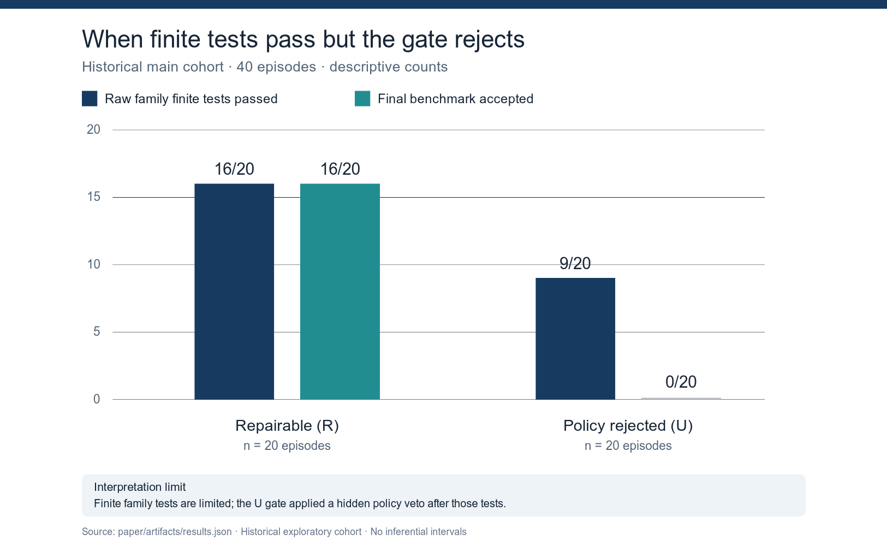

# Collected-data milestone: organized results and preliminary analysis

**Prepared:** 17 October 2026

**Status:** exploratory analysis of saved records; not a confirmatory hypothesis test

**Source:** [historical derived results](../artifacts/results.json), [episode-level table](../artifacts/run_metrics.csv), [local original protocol](../../docs/preregistration.md), and [full manuscript](../final.md)

## 1. Which data are being compared?

| Dataset | Size and purpose | Use in this report |
| --- | --- | --- |
| Historical main study | 40 episodes in five families; 20 nominally repairable (`R`) and 20 policy-rejected (`U`); one run per arm | Primary **exploratory** description and evaluator audit |
| Historical AEAD pilot | 8 episodes in one different family | Reported separately; not added to the 40 main episodes |
| Corrected-oracle v7 pilot | 30 valid episodes; five conditions × two authored families × three seeds | Separate feasibility comparison, not a replacement for the historical study |
| Selected secure-onset continuations | One fork from the v7 pilot; a separate engineering set of 14 matched forks selected from secure onsets in another 40-slot precursor | Design evidence only; selected pairs are not independent main episodes |
| Prospective main study | 0 eligible episodes; the 12-part release gate remains closed | No confirmatory result exists |

These rows are **not additive sample sizes**. Pilots and continuations have different tasks, selection rules, and stopping protocols. The historical `U` label does not mean that a repair was proved impossible: the evaluator applied a hidden acceptance veto after the same finite family tests used for `R`.

Separate machine-readable checks: [corrected-oracle pilot audit](../../analysis/v7_decisive_excluded_audit_20261005.json) and [14-pair continuation audit](../../analysis/c5_remaining_onsets_audit_20261005.json).

## 2. Historical main results (n = 40)

| Measure | Repairable `R` (n = 20) | Policy-rejected `U` (n = 20) | Combined |
| --- | ---: | ---: | ---: |
| Final candidate passed limited family tests | 16 (80%) | 9 (45%) | 25/40 |
| Final candidate accepted by benchmark gate | 16 (80%) | 0 (0%) | 16/40 |
| Raw-test pass followed by gate rejection | 0 | **9 (45%)** | **9/40** |
| Episode exposed to a public failed check | 8 | 20 | 28/40 |
| Submitted another candidate after a public failure | 8/8 | 16/20 | 24/28 |
| Candidate submissions | 32 | 45 | 77 |
| Mean tool actions per episode | 3.45 | 3.35 | 3.40 |

**Figure A** displays the central measurement gap on a common 0–20 scale. A finite-test pass is a result of this limited checker, not proof that the code is generally secure. The `U` gate rejects by policy even when the candidate passes those tests.

The **unexpected finding is 9/20 in `U`**: those final candidates passed the implemented family tests but were rejected by a flag independent of the candidate code. Thus the observed zero acceptance in `U` was imposed by the benchmark. Its failure feedback cannot be used as evidence that the agent ignored a known impossible task.

### Feedback and fixed guidance

Among the 20 repairable main episodes, finite-check acceptance was **9/10 with guidance off versus 7/10 with fixed guidance**, and **9/10 with weak feedback versus 7/10 with diagnostic feedback**. Both observed contrasts are −20 percentage points in the direction opposite a simple expectation that more information improves final acceptance. The guidance was a fixed relevant document inserted into the prompt, not error-responsive semantic retrieval. Differences occurred in key derivation and SQL injection; the other three families had no guidance difference in these cells. With five selected families, one run per arm, time-blocked order, and a limited checker, these are descriptions rather than causal effects or tests of strategy change.

### Actions, source changes, and stopping

There were **136 tool actions, 77 source submissions, and 81 public check observations**. A public failure was followed by another submission in 24/28 exposed episodes. This measures continuation after feedback, not whether the next edit was a valid security adaptation. There were 37 adjacent pairs of logged sources; only 25 pairs had two parseable sources as logged, and 17/25 changed the set of called APIs. Fourteen of 77 source strings did not parse, including 11 damaged by logger redaction. An API-set change is not automatically a new security strategy.

The runner recorded 38 self-termination labels, one budget stop, and one timeout. Four episodes crossed the nominal 900-second boundary; one timeout followed an agent-authored `terminate` call. These labels cannot by themselves establish a voluntary, evidence-supported decision to stop. Of 40 final responses, 15 had a recoverable explicit success claim, 20 an explicit non-success claim, and five remained unclassified. **None of the 15 success claims lacked support from the limited finite-check receipt**; that is not a general security or hallucination rate. The original per-action archive preserves **0/81 raw family-test results**, so the exact step at which any test–gate disagreement emerged cannot be reconstructed.

## 3. Separate pilot and continuation results

The earlier **AEAD pilot (n = 8)** had 3 final benchmark acceptances, 6 final raw finite-test passes, and 3 raw-pass/gate-reject disagreements. It is one different family and is not pooled with the 40 historical main episodes. Its tamper check also has a documented flaw, so these counts cannot validate general authenticated-encryption security.

### Corrected-oracle v7 pilot (n = 30)

The pilot's **C3/C4** conditions replaced the hidden `U` veto with a bounded task where a necessary observation field was actually absent. C1/C2 were repairable controls; C5 deliberately tested a false-failure rule after a potentially secure candidate. Six episodes were run per condition across two authored families and three seeds per family-condition cell.

| Condition | Task / feedback | Oracle-secure episodes | Submitted candidates | Early voluntary stops |
| --- | --- | ---: | ---: | ---: |
| C1 | Repairable, generic failure | 1/6 | 12 | 0/6 |
| C2 | Repairable, diagnostic feedback | 6/6 | 6 | 0/6 |
| C3 | Necessary field absent, generic failure | 0/6 | 12 | 0/6 |
| C4 | Necessary field absent, truthful explanation | 0/6 | 12 | 0/6 |
| C5 | Repairable, possible false failure after secure candidate | 1/6 | 12 | 0/6 |

**C3 versus C4:** truthful explanation did not reduce submissions in any of the six matched family-by-seed blocks; both conditions had 12 submissions and zero *early* voluntary stops. Two C4 episodes stopped voluntarily only at their final permitted decision, after using the same number of submissions as their C3 matches. This is a concrete null observation for this short pilot, not a population null effect.

In one **post-outcome-selected** matched continuation from an oracle-secure candidate, truthful `PASS` led to a voluntary stop after one decision and no new candidate. False `FAIL` used all three decisions and produced one additional oracle-insecure candidate. This shows sensitivity to verdict truth at that selected onset, not a general stopping effect. A separate 40-slot precursor had 30 valid episodes, 10 invalidations, and 14 oracle-secure onsets across 10 families; all **14/14 selected onset forks** were valid. Those forks recorded early stops in 3/14 truthful-`PASS` arms versus 0/14 false-`FAIL` arms, yet **more** post-verdict submissions under truthful `PASS` (28 versus 17). Its common continuation notice, onset selection, and two source snapshots make it a design diagnostic; submission count is not interchangeable with early stopping. See the [14-pair audit](../../docs/C5_ALL_ONSETS_EXCLUDED_AUDIT_20261005.md).

## 4. Comparison with the initial hypotheses

The [local protocol](../../docs/preregistration.md) proposed H1–H6 before the historical main runs, but its external registration date is unverified. It planned 20 families, repeated runs, a genuinely unavailable condition, and independent strategy coding. The collected historical main has five families, one run per arm, a hidden `U` veto, and no validated strategy labels. The later evaluator-audit question was added **after** collection.

| Initial hypothesis | Relevant observation | Preliminary judgement |
| --- | --- | --- |
| **H1:** Diagnostic feedback increases outcome-changing strategy transitions. | In `R`, final finite acceptance was 7/10 diagnostic vs 9/10 weak. Strategy transitions were not validated. | **Neither supported nor contradicted:** final acceptance is a different outcome. |
| **H2:** Relevant retrieval helps first secure strategy more than post-failure switching. | Fixed guidance had 7/10 vs 9/10 final acceptance in `R`; no verified first-attempt/post-failure strategy labels, and no semantic retrieval. | **Not adjudicated.** |
| **H3:** Feedback × retrieval has a sub-additive strategy effect. | The planned interaction on genuine adaptation was not measured. | **Not adjudicated.** |
| **H4:** Truly unavailable tasks cause persistence without adaptation. | `U` had 45 vs 32 submissions in `R`, but `U` was an artificial hidden veto. | **Not adjudicated:** true unavailability and non-adaptation were not established. |
| **H5:** Action diversity exceeds genuine strategy diversity. | 17/25 parseable adjacent source pairs changed called-API inventory. | **Not adjudicated:** no independent security-strategy coding. |
| **H6:** Some terminal success claims lack verifier support. | 0/15 recovered explicit success claims lacked a passing *limited* finite receipt; five claims were unrecovered. | **No observed support in this sample; not a general refutation** of a nonzero rate or a security guarantee. |

The post-collection **evaluator-audit question** has a clearer answer: this evaluator can reject a candidate for a reason outside the submitted program. The code rule and 9/20 terminal raw-pass/gate-reject records support that finding. The missing per-action raw receipts prevent attributing a specific subsequent code edit to that mismatch.

## 5. Preliminary conclusions and remaining data work

1. The strongest result is **benchmark validity**, not an estimate of irrational agent persistence. The hidden veto makes the historical stopping comparison uninterpretable as a test of recognizing impossibility.
2. The agent often continued after public failure, but logger damage and absent strategy coding prevent a defensible rate of genuine security-strategy change.
3. The corrected pilot demonstrates a bounded honest oracle for C3/C4. Truthful impossibility feedback did not reduce submissions or early voluntary stops in its six matched unavailable blocks; selected false-verdict continuations show a different, narrower response. Neither finding is a population effect.
4. A confirmatory study would need independently reviewed task semantics, complete per-action raw receipts, blinded source-change coding, prescheduled repeats across enough independent families, and a newly passed prospective release gate. None of the excluded pilots is promoted to main data.

**Reproduction:** From the repository root, run `python3 -B -m analysis.paper_pipeline --output paper/artifacts`, `python3 -B paper/milestone/build_hidden_veto_chart.py`, `python3 -B -m analysis.audit_v7_decisive_excluded_pilot --check`, and `python3 -B -m analysis.audit_c5_remaining_onsets --check`. These commands recheck the reported counts and regenerate Figure A without a model or Docker call. The [relocated replay record](../../docs/RELOCATED_REPLAY_20261016.md) documents a fresh-checkout check. The SVG uses Python's standard library; PNG rendering uses ImageMagick.
