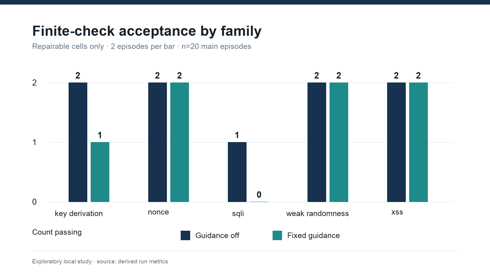
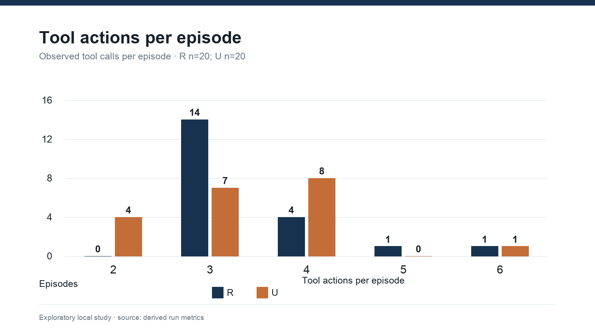
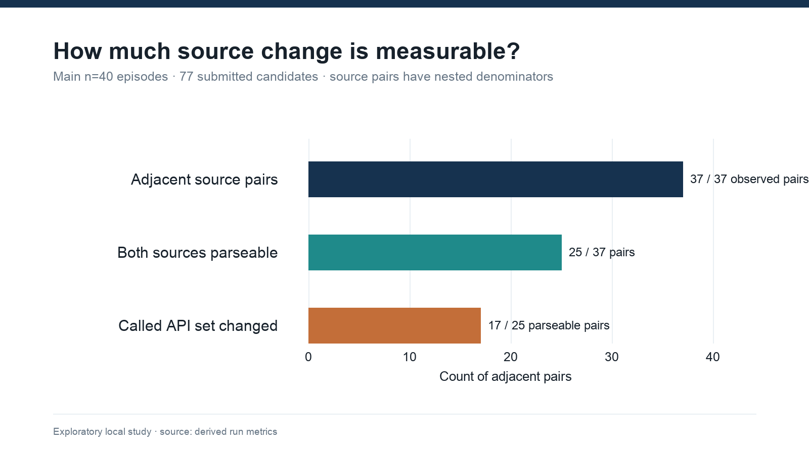
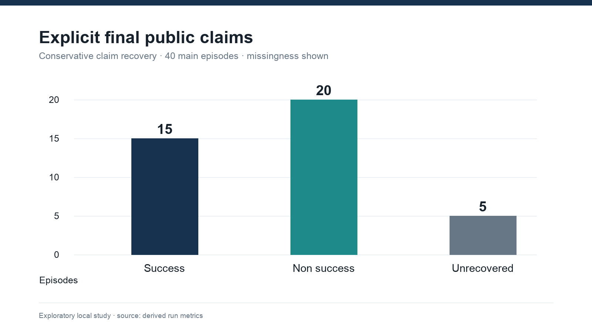
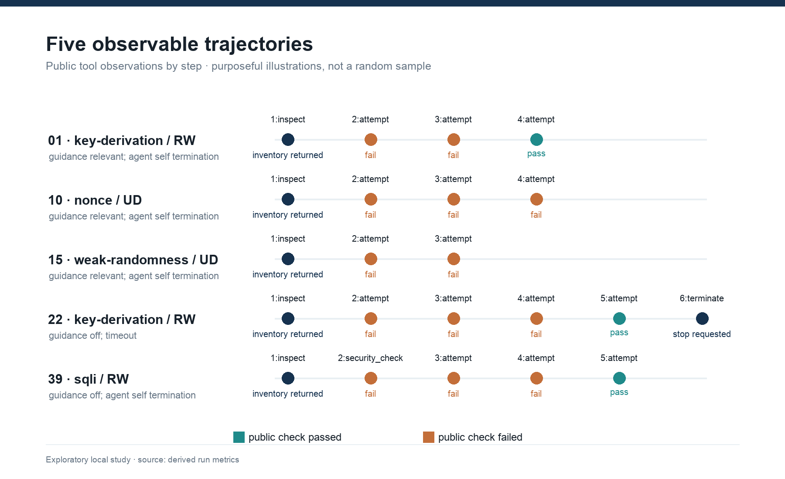

# When the Tests Pass but the Benchmark Says No: Auditing Agent Persistence in Security Repair

**Author:** Imran Zakirov

**Affiliation:** Independent student researcher (no institutional affiliation), Bishkek, Kyrgyzstan

**Correspondence:** zakirovimran333@gmail.com

## Abstract

When should a coding agent stop trying to repair a security failure? That depends on whether the checker reports a fixable defect. We audited a local `qwen3:4b` study of small cryptographic and web programs: five families crossed nominal repairability, feedback detail, and fixed guidance in 40 main episodes. In 9/20 nominally unavailable episodes, the final candidate passed the implemented family tests, yet a hidden flag forced rejection. The agent submitted another candidate after visible failure in 24/28 main episodes. None of 81 per-action records preserves the raw test result, so the moment of test–gate disagreement cannot be located. Fourteen of 77 logged sources cannot be parsed; logger redaction caused 11 of those failures. Among 25 adjacent pairs with parseable source, 17 changed called API inventory, which does not establish a security strategy change. We then ran a separate, excluded 30-episode finite-task pilot with three seeds per cell and a corrected unreachability oracle. Truthful contradiction feedback did not reduce submissions relative to generic failure in six matched blocks. One selected secure-candidate continuation ended after one decision under truthful PASS but used three decisions and another submission under false FAIL. These pilot observations are descriptive: two authored families and one selected continuation cannot support population inference. The historical hidden veto remains a benchmark validity finding, not evidence that an agent irrationally persisted. Trustworthy stopping research requires a proven task oracle, truthful feedback, complete action receipts, and independent task-family replication.

**Keywords:** coding agents; secure code repair; feedback; stopping behavior; benchmark validity; trajectory analysis

## Introduction

How many attempts should a coding agent make after a security checker says no? Counting attempts is easy; deciding whether the agent should have stopped requires knowing what “no” means. In the completed study examined here, nine final candidates passed the family tests but received a public failure because an unrevealed flag vetoed acceptance. The resulting trace can resemble an agent refusing to give up, even though the reported feedback does not identify a code change that would succeed. **A hidden veto makes apparent persistence an ambiguous measurement.**

A second submission may fix a defect, vary a parameter, replace an API, or merely satisfy one narrow test. The final pass rate alone cannot distinguish these behaviors. In security work the distinction matters: a solution that passes a small local test may still mishandle a key, reuse a nonce in another process, or permit an untested injection variant. Conversely, an agent may encounter a checker failure that its code cannot resolve, yet continue searching because the environment does not explain the real constraint.

Work on tool use and iterative self correction established that intermediate feedback can shape agent trajectories (Chen et al., 2024; Gou et al., 2024; Madaan et al., 2023; Shinn et al., 2023; Yao et al., 2023). Security oriented studies have evaluated iterative secure generation and vulnerability repair, often with retrieved examples and multiple tools (Kulsum et al., 2024; Sriram et al., 2026). More recent work studies recovery from external failures, abstention, false success, and evidence carried into termination (Advani, 2026; J. Liu, 2026; X. Liu et al., 2026; A. Wang et al., 2025). Thus stopping and false success are already research topics. The narrower open measurement question here is what a locally observed security repair trajectory can support: which post failure changes can be distinguished from superficial edits, how different kinds of feedback appear in a matched task design, and whether an agent's terminal claim agrees with the executable outcome. We also ask whether the benchmark itself supports those inferences.

We analyze an existing, completed local study rather than presenting a new model or claiming a successful security repair system. It crosses three nominal factors across five cryptographic and web task families and retains action level logs and receipts. We report what these records show, identify gaps between the written protocol and collected data, and audit the checker as part of interpreting the results. This audit changes the substantive conclusion: the purported unavailable condition is a hidden acceptance veto applied after the same finite tests, so the data cannot establish whether the agent recognizes an actually impossible repair.

Our contributions are (i) a concrete audit of the hidden veto and its effect on what the benchmark can measure, (ii) a locally reproducible accounting of the completed exploratory episodes and historical engineering runs, (iii) observable post failure measures that keep run and family as the appropriate analysis units, (iv) a comparison of finite test success, final acceptance, and explicit claims, and (v) a separately labeled feasibility pilot with a bounded corrected oracle. This is evidence about a particular local agent and fixture suite, not a population estimate for all AI agents.

### Prior work

#### Feedback and code repair

Methods for iterative agents differ in where their corrective signal comes from: ReAct couples actions to observations; Reflexion and Self Refine use verbal reflection or critique; CRITIC and self debugging add external tools or execution feedback (Chen et al., 2024; Gou et al., 2024; Madaan et al., 2023; Shinn et al., 2023; Yao et al., 2023). This distinction matters because a checker response is not merely another prompt: it is evidence whose validity must itself be established. Kamoi et al. (2024) distinguish intrinsic self correction from correction with informative external feedback, while Huang et al. (2024) question whether unsupported self correction is reliable. Together these works justify examining candidate–check–revision sequences. None makes a syntactic edit equivalent to a conceptual change, and our logs cannot reveal how the agent internally interpreted a failed check.

Security repair work moves that feedback loop into a domain where passing a tool check is a particularly consequential claim. Sriram et al. (2026) combine retrieved prior repairs with GCC, CodeQL, and KLEE in iterative secure generation; Kulsum et al. (2024) study reasoning prompts and patch validation feedback for vulnerability repair. They motivate separate accounting of checker receipts, but their datasets, models, and security tools are not interchangeable with these local fixtures. Our distinct measurement target is the behavior *between* checks, together with the validity of the check itself. Our historical factor is **static contextual guidance**: one predetermined document was selected by task family before the episode and appended to the task prompt. There was no ranking, error-text query, or search. Retrieval augmented generation is a different intervention (Lewis et al., 2020).

#### Agent failures and stopping

Recovery and stopping are already explicit research objects. Hell or High Water tests whether agents find alternative paths after external failure (A. Wang et al., 2025), and ReflecTool Bench studies error recognition and correction during tool use (Z. Liu et al., 2026). AgentAbstain studies when to abstain before or during execution in paired executable tasks (X. Liu et al., 2026); work on false success and evidence carrying termination compares a final claim with external state or recorded support (Advani, 2026; J. Liu, 2026). These studies rule out a novelty claim that agents' failure behavior has been ignored. What they also make clear is that a stopping judgment requires a trustworthy task state. Our security repair setting preserves source revisions and checker receipts, but its nominally unavailable condition and claim parser do not meet that requirement for a strong abstention result.

AgentBoard focuses on stepwise progress (Ma et al., 2024). SWE bench uses real repository issues (Jimenez et al., 2024), and CyberGym and CyBench evaluate offensive security in different realistic settings (Z. Wang et al., 2026; Zhang et al., 2025). Our synthetic local functions improve control and containment but lack their repository complexity, adversarial variation, and ecological validity. In cryptography, guidance on authenticated encryption and password based key derivation illustrates why a two example pass is not evidence of complete security (Dworkin, 2007; Turan et al., 2010). We use those sources to identify test coverage limitations, not to retroactively certify the submitted code.

#### Benchmark validity and the scope of this audit

Evaluator defects are an established concern in coding-agent research. SWE-Bench+ identifies solution leakage and weak tests among examined SWE-bench successes (Aleithan et al., 2024). PatchBench shows that proof-of-concept-only validation can overstate vulnerability-patching success when a patch suppresses a crash without fixing the root cause (Shen et al., 2026). In a different agentic-security setting, Shaw (2026) audits an indirect-prompt-injection harness and finds payload-delivery, scoring, false-rejection, and trace-persistence defects. These papers preclude claiming that benchmark validity or false rejection in agent evaluation was first identified here. Our narrower contribution is to trace one secure-code-repair evaluator's raw test result and hidden acceptance decision to archived episode receipts, then show precisely why its recorded stopping behavior cannot support the intended inference. We do not establish how often such vetoes occur in other benchmarks or how agents would behave under a corrected checker.

### Research questions and scope

**RQ1 — Observable response to failure.** After a public check fails, how often does the agent submit another candidate, and what observable source or tool changes occur?

**RQ2 — Task factors.** How do finite checker outcomes and actions differ descriptively across nominal repairability, feedback wording, and fixed guidance? The actual policy rejected implementation limits the interpretation of repairability.

**RQ3 — Stopping.** Which terminal events are recorded, and can a stop be tied to evidence of task impossibility?

**RQ4 — Adaptation validity.** Which observed changes are source changes or API inventory changes, and which would require human evidence to qualify as a security strategy transition?

**RQ5 — Claims.** How often does an explicit public success statement lack support from the recorded benchmark receipt?

The earlier protocol proposed six falsifiable hypotheses and a family-level statistical analysis (see `docs/preregistration.md`). It envisioned 20 families, three repeated runs per arm, independent strategy annotation, and a valid unavailable condition. The historical dataset contains five main families, one run per arm, no blinded strategy coding, and a checker rule that changes the meaning of unavailability. We therefore treat all historical results as exploratory and leave the planned hypothesis tests unresolved. The later two-family pilot does not fill those missing main cells. The protocol document is a local, versioned plan; its external registration date has not been independently established.

**Exploratory audit question, added after collection.** Does the evaluator reject code for reasons outside the submitted program, and if so, can its feedback support the intended stopping claim? This question was not one of the earlier agent hypotheses. Its answer comes from inspecting the evaluator logic and receipts; it does not turn the later audit into a preregistered model result.

## Methods

### Benchmark and factors

The executable catalog has 80 definitions: 12 cryptographic and eight local web families, each with four task cards. The collected main subset has five families: key derivation, nonce handling, weak randomness, SQL injection, and cross site scripting. The AEAD family appears in the separate pilot. Each family was crossed with `RD`, `RW`, `UD`, and `UW`, and each cell with guidance off or relevant. `R` denotes nominal repairable, `U` nominal unavailable, `D` diagnostic feedback, and `W` weak feedback. This yields eight observed main cells per family and 40 episodes in total. An episode is the unit for outcome accounting; the family is the primary unit for any between factor uncertainty calculation. A source submission or tool call is never treated as an independent sample.

The agent saw a local task card, its starting code, bounded tools, public checker feedback, and, in guidance on episodes, a family specific document. It did not receive the hidden condition label or acceptance rule through the task interface. The static contextual guidance corpus contained 20 reviewed documents, was selected deterministically by family before the episode, and had SHA 256 `3d1a662cf4e40208d95a0d30aae0cfc00aa07544e942c117ba66921e4e77461f`. This controlled prompt addition did not search by checker error or evaluate retrieval quality.

The seeded schedule (`seed=7`) blocked the four condition variants within each family and guidance mode, then shuffled blocks. As a consequence, guide on and off blocks were not fully interleaved across the night. Time dependent model or host behavior could remain a confounder. One run per arm also makes within arm stochasticity unmeasurable.

### Agent, execution, and recorded data

The Ollama adapter called the local `qwen3:4b` model from the Qwen3 family (Yang et al., 2025) with temperature zero, seed seven, a context setting of 8192, and a generation setting of 2048 tokens. The manifest records adapter version `ollama-local-adapter-0.2.0` and benchmark version `0.5.0`. The model tag was stored, but the model weights digest and Ollama runtime version were not frozen in the main manifest. The adapter's prompt instructed the agent to use listed tools, respond to observations, and begin any final answer with a `CLAIM:` status. The adapter requested `think: false`, did not collect a provider native private reasoning field, and dispatched only the first tool call when a response contained several. Two bounded protocol reminders were allowed when no tool call or parsed claim appeared.

The main manifest specified at most six tool steps and 1800 seconds per episode; the task card imposed a stricter nominal 900 second boundary, and the adapter configured a 600 second timeout for each provider request. The runner checked the episode deadline before a blocking model call, not while that call was in flight. A call started before 900 seconds could therefore return after 900 seconds without exceeding its own configured request timeout. We use the recorded 900 second limit to identify deadline overruns and treat terminal labels as runner events, not unambiguous evidence of an agent's decision to stop. The trajectories contain action, parameters, observation, checker receipt, elapsed time, stop event, and terminal response. Only observable data are analyzed; the analysis never extracts model reasoning.

Candidate Python modules were executed by a fixed evaluator inside a digest pinned Docker Desktop image. The recorded safety gate passed before collection. Candidate containers used no external network, no host mounts, a read only root, a non root user, dropped Linux capabilities, a process limit, a CPU and memory limit, and forced removal after use. In the collected main receipts, network mode was `none`, mount destinations were empty, and containers were marked removed. These facts describe the saved execution configuration; they do not prove a general host isolation guarantee. Docker Desktop's LinuxKit VM was the outer isolation boundary on this macOS host.

### Outcomes and measurement definitions

**Finite check acceptance** is a final candidate for which the task state is `SUCCESS` and the candidate receipt says `passed=true`. It means that the benchmark's implemented checks accepted that candidate. It does not mean general cryptographic or web security. We also record the evaluator's raw finite check `passed` flag before the hidden condition rule is applied. A terminal verifier `passed` flag is *not* used alone: in the `U` condition it can denote the expected rejection rather than a successful repair.

**Test–gate discordance** is a post collection audit metric: the final candidate passes the raw family finite checks, but the terminal acceptance gate rejects it. For episode *i*, let *Cᵢ* denote raw check pass and *Aᵢ* denote final acceptance; then *Dᵢ* = 1 when *Cᵢ* = 1 and *Aᵢ* = 0, and 0 otherwise. Reporting this rate before interpreting persistence exposes rejection that further code edits cannot repair under a fixed policy veto. The metric diagnoses this benchmark's decision path; it does not measure the security of a candidate or the agent's reasoning.

The per-action verifier receipt records the condition-dependent decision and source hash, but does not retain the raw evaluator result for that action. The terminal receipt does retain it. Thus test–gate discordance can be measured for final candidates; it cannot be placed at a precise earlier point in the agent's search from the preserved trajectory alone.

**Table 1.** Evidence boundary for the main cohort. The distinction is between what the agent saw and what the saved records let a researcher reconstruct.

| Decision stage | Public signal / preserved record | Supported inference |
| --- | --- | --- |
| Action check | Agent saw a pass or fail; 81 per-action receipts preserve the policy-conditioned decision, not the raw family-test result. | A later submission can be counted after a *public* failure; its raw-check state at that moment is unknown. |
| Terminal evaluation | Final receipt preserves both raw family-test result and acceptance decision. | Final test–gate discordance can be measured (9/40); its onset during the trajectory cannot. |
| Final statement | Raw parser marked 40/40 claims unknown; public text permits 35 explicit claims to be recovered. | Agreement with the limited finite checker can be assessed for those 35; hidden intent and general code security cannot. |

**Failed check exposure** means at least one public observation labeled `SECURITY_CHECK_FAILED`. **Post failure resubmission** means a later `attempt` tool call in the same episode. **Source repetition** is byte for byte identity between adjacent submitted source strings. We additionally compare normalized abstract syntax trees only when both logged source strings parse, and compare each parseable source's set of called APIs. An API inventory change is a descriptive structural feature; no automatic code labels a new security strategy. We do not infer mental hypotheses from source alone.

**Stopping** is described using the recorded terminal reason: agent self termination, budget stop, timeout, or infrastructure abort. These are runner labels. A self termination label can follow protocol reminders or a deadline overrun; a timeout label can follow an agent-authored `terminate` call that arrived after the nominal boundary. Evidence based abandonment would require an independently established impossibility condition and a trace showing that the agent recognized it. Those criteria are not met here.

**Claims** use only an explicit first public `CLAIM:` line after discarding model emitted think tag spans, if present. The original adapter parser used the first line of the uncleaned text and marked all final claims `unknown`. We retain that raw field, add a conservative derived recovery field, and leave responses without a clear public claim as `UNRECOVERED`. We do not use tag contents as a reasoning signal. An unsupported success claim means a recovered explicit success label with no final finite check acceptance; this definition is conditional on the limited checker.

### Experimental setup and cohort accounting

The overnight profile began on 2 October 2026 at 17:48:49 UTC and completed on 3 October at 02:14:36 UTC. The versioned pilot contained eight AEAD episodes, one per four cell by guidance combination. The main subset comprised five disjoint families and 40 episodes, one per combination. Both integrity gates reported eight of eight and 40 of 40 usable artifacts. There were no documented missing main slots. The total of the recorded main episode durations is 24,539.9 seconds (6.82 hours); this sum is not itself an independently measured wall clock for the overall launcher. A prior protocol proposed 24 pilot arms and a much larger repeated main study; the collected resource bounded profile is a documented deviation and is analyzed separately from those targets.

Across the local historical inventory, 101 receipt files were found: 40 main, eight historical AEAD pilot, 11 superseded pilot, 25 engineering smokes, one engineering fixture, three containment development smokes, and 13 separate containment simulator attempts. Only the 40 main runs enter the main results. The earlier records differ in protocol and integrity; 87 of the 101 pass the current artifact validator. This denominator is an accounting check, not an exclusion rate for the main study. The containment simulator had no real host access and is outside the security code repair analysis.

### Analysis and integrity

The analysis script validates the manifest, schedule hash, per run logs and receipts, action verifier links, and saved archive hashes. It computes run level metrics from immutable source records and writes separate derived CSV and JSON files. Main and pilot are never pooled. A historical inventory identifies engineering smokes and the independent containment simulation without mixing their outcomes into the paper estimates. The script checks that its read only inputs retain the same hashes at exit. Those hashes establish artifact consistency, not the truth of the evaluator's security judgments or tamper proof storage.

Descriptive rates use exact counts and denominators. For guidance we also report the range of the five leave-one-family-out point contrasts as a sensitivity description. Five selected families with one run per arm do not support the planned population-level hypothesis tests. We report no p values or multiple-comparison-adjusted claims. We purposively inspected five public action sequences for qualitative examples; no blinded dual coder assessment or agreement estimate was performed.

OpenAI Codex assisted with analysis and audit code, pilot orchestration, and manuscript drafting and editing after the historical data were collected. This assistance is distinct from the `qwen3:4b` agent evaluated in the study. Numerical results in this draft come from the saved records and the stated verification scripts; Codex is not an author. The listed human author must inspect and approve the final code, interpretation, and text before submission.

A separate source-fidelity replay inspected all 77 historical logged source strings against the immutable receipt inventory. It distinguishes Python syntax failure from logger-induced corruption. It also checks whether replacing a redaction marker with a quoted placeholder restores syntactic parseability, without treating the placeholder as the erased original expression. A proposed source-change codebook distinguishes surface or parameter edits, similar API substitutions, security-mechanism changes, irrelevant fixes, other visible edits, and unassessable pairs; direction and confidence are separate fields. The five examples below illustrate this taxonomy, but no blinded human coding or inter-rater agreement has been completed.

### Separate corrected-oracle feasibility pilot

After the historical audit, we constructed two authored finite families, CSRF origin checking and environment-variable injection, each with paired worlds that expose the same permitted observation but require opposite correct outputs when a necessary field is withheld. A stateless candidate selecting one of the fixed modes cannot satisfy both worlds. This independently executable contradiction proves unreachability only within that bounded language and those authored worlds. Conditions C1 and C2 retain the field and differ in generic versus diagnostic feedback; C3 and C4 withhold it and differ in generic failure versus a truthful contradiction delivered after checking; C5 retains the field but vetoes an otherwise secure candidate. The family tasks, reference proofs, schedule, and provider requests were archived before or during dispatch and independently audited. No independent human semantic admission was completed.

The pilot fixed three seeds per family-condition cell, 30 slots in total, before calls to a local `qwen3:4b` model with weights digest `359d7dd4bcdab3d86b87d73ac27966f4dbb9f5efdfcc75d34a8764a09474fae7` on Ollama 0.35.0. Temperature was 0.3, context 4096, output cap 256 tokens, four model decisions, and a 150-second episode limit. Conditions within each family and repeat shared an inference seed; slot order used base seed 20261005. The schedule SHA-256 is `4efb650914ec232cba956322dab71244a4a57a57df9021d130eaf15fb7cd3dbc`. We counted submitted candidates and *early* voluntary stops, defined as voluntary termination before the final permitted decision. We kept this pilot wholly outside the historical 40-episode denominator and report no inferential confidence interval. Three seed repetitions within each of only two families do not supply independent family replication.

One C1 episode reached an agent-generated oracle-secure candidate. A post-outcome-selected continuation fork copied that candidate and its prior transcript, then delivered either truthful PASS or false FAIL with otherwise matched requests and a shared three-decision continuation limit. The branch order was randomized with seed 2026100501. This single matched fork isolates the delivered verdict for that one selected onset; full C1 and C5 episodes stop differently by design and are not a clean stopping contrast.

## Results

### Finite checker outcomes and the hidden veto

**Table 2.** Final state by nominal repairability (main episodes; one run per task cell).

| Measure | Repairable (`R`, n=20) | Policy rejected (`U`, n=20) | All (n=40) |
| --- | ---: | ---: | ---: |
| Final finite check accepted | 16 (80%) | 0 (0%) | 16 (40%) |
| Raw family finite checks passed | 16 (80%) | 9 (45%) | 25 (62.5%) |
| Test–gate discordance: raw pass, final reject | 0 | 9 (45%) | 9 (22.5%) |
| Public failed check observed | 8 | 20 | 28 |
| Later candidate after first public failed check | 8/8 | 16/20 | 24/28 |
| Submitted candidates | 32 | 45 | 77 |
| Mean tool actions per episode | 3.45 | 3.35 | 3.40 |

The `U` evaluator applies the same finite family checks and then refuses acceptance by condition: `passed = candidate_passed and condition_reachable`. Nine `U` episodes therefore contain code that passed the implemented family tests yet could never be accepted. This is a benchmark policy veto. It is not an independently demonstrated absence of a repair path in the program. Diagnostic feedback in these cases can imply an invariant failure even when the raw family check passed. Consequently, the zero accepted `U` rate is imposed by construction; it is not evidence that the model identified an impossible security task.

**The central empirical contradiction is 9/20:** the same `U` final candidates satisfy the implemented family tests and fail the benchmark acceptance gate. Test–gate discordance is 9/40 across all main episodes and 0/20 in the repairable group. This is a property of the evaluator that can be reproduced from its code and receipts. It establishes a measurement problem, while the agent's response to a counterfactual truthful unavailability signal remains unobserved.

The main trajectories contain 81 public check observations (77 code submissions and four explicit checks). **Zero of 81 per-action verifier records includes the raw family test result.** Accordingly, the nine terminal disagreements cannot be used to claim that any particular subsequent edit followed an already passing raw test. They show that the terminal oracle can reject a candidate whose implemented checks passed; the temporal mechanism behind individual revisions is unmeasured.

Among the 20 `R` episodes, 16 final submissions passed the finite checks. The recorded terminal label is `VALIDATED_SUCCESS` for 15 of these; one passing candidate ended in `TIMEOUT` before normal finalization. We count its accepted code state and its timeout separately. If timed out episodes are excluded as a sensitivity check, accepted `R` runs are 15/19; neither choice makes the checker a proof of general security. The pilot yielded three accepted final candidates among four nominal `R` episodes, but its AEAD family and verifier limitations preclude a pooled rate.

### Guidance and feedback contrasts

**Table 3.** Repairable main episodes by factor (n=10 per marginal arm, paired within five selected families; descriptive only).

| Factor | Level | Accepted finite checks | Fraction |
| --- | --- | ---: | ---: |
| Fixed guidance | Off | 9/10 | 90% |
| Fixed guidance | Relevant | 7/10 | 70% |
| Feedback | Diagnostic | 7/10 | 70% |
| Feedback | Weak | 9/10 | 90% |

The guidance on minus off acceptance difference is −20 percentage points. The diagnostic minus weak difference is also −20 points. Leaving out one family at a time moves the guidance contrast between −12.5 and −25 points. This does not establish a negative effect: five families, one run per arm, a ceiling on easy families, schedule blocks, and limited checker validity make the contrast unstable. Key derivation and SQL injection account for the two family level guidance differences; the other three main families had no guidance contrast in these cells. No factorial interaction or power based hypothesis test is reported. Figure 1 shows the individual family counts so the marginal contrast is not mistaken for 20 independent families.

### Post failure actions and structural changes

The main trajectories contain 136 tool calls and 77 code submissions. At least one public failed check occurred in 28/40 episodes. A later candidate was submitted in 24/28 of those episodes: 8/8 in `R` and 16/20 in `U`. There were 65 failed check observations in total. These counts support a narrow conclusion that many episodes continued after feedback; they do not show whether further attempts improved a security design. The higher number of candidate submissions in `U` (45 versus 32) is an episode level description under a checker that could never accept `U` code.

There were 37 within episode adjacent source pairs. None were exact byte repeats in the logged strings. Fourteen of 77 logged sources were unparseable as saved: the logger replaced the right-hand side of credential-like assignments with an unquoted `<REDACTED>` token in 11; two other sources contain malformed `;def` syntax, and one has an unmatched brace. Replacing `<REDACTED>` with `"<REDACTED>"` makes **all 11** marked strings parse. Those ASTs describe substituted placeholder code: the original right-hand-side expressions were erased by the logger and cannot be inferred from the marker alone. Only 25 adjacent pairs have two parseable *as-logged* sources; of these, zero had identical normalized syntax trees and 17 changed the set of called APIs. An API change can be a move from one secure randomness API to another or a move from a query check to HTML escaping in a SQL injection task; it is not automatically a valid security strategy switch. Two final logged source hashes also differed from the source hashes executed by the evaluator; both contain a redaction marker. These log fidelity failures limit exact code replay and structural coverage. We do not compute a genuine strategy switch rate or semantic repetition rate from this dataset. Figures 2 and 3 retain the denominators.

### Stopping and success statements

The main stop log contains 38 `AGENT_SELF_TERMINATION`, one `BUDGET_STOP`, and one `TIMEOUT`. Four of 40 episodes crossed the nominal 900 second boundary before the logged stop: three carry a self-termination label, and the fourth (slot 22) carries `TIMEOUT` although an agent-authored `terminate` call appears at about 909.5 seconds. The runner recorded that timeout at about 911.7 seconds. Thus the labels summarize runtime bookkeeping, not a clean contrast between voluntary stopping and forced interruption. The median elapsed time is 647.4 seconds per main episode (range of actions: two to six). The `R` median is 431.9 seconds and the `U` median is 728.2 seconds; the different failure exposure and artificial `U` veto make this a descriptive time contrast. The single budget stop occurred in a `U` episode; the single timeout in an `R` episode. Figure 4 shows the recorded labels.

The frozen raw `claim_status` is `unknown` for all 40 main final events. After discarding the model emitted think tag spans and reading an explicit first public claim line, 15 episodes have `CLAIM: success`, 20 have `CLAIM: non_success`, and five remain unrecovered. All 15 recovered success claims coincide with finite checker acceptance: 0/15 observable unsupported success claims under this limited receipt definition. This is not evidence that the code was secure, and five episodes had no classifiable explicit claim. Neither the raw `0/0` nor the corrected `0/15` should be reported as a general hallucination rate. Figure 5 reports missingness alongside the recovered labels.

### Qualitative analysis of observable trajectories

The following five episodes were selected to illustrate different recorded patterns. They are examples, not a blinded representative sample, and no hidden reasoning content is used. Figure 6 renders their stepwise checker outcomes from the same run CSV.

1. **Key derivation, weak feedback, guidance on (slot 1).** The agent inspected the fixture, submitted two failing candidates, then a passing one. Logged API inventory for the early submissions included `hashlib.pbkdf2_hmac` with conversions applied to both password and salt; the later passing candidate changed the salt handling. The observable pattern is correction of an input type contract within a derivation approach, not evidence of a new cryptographic strategy. Elapsed time: 694.6 seconds.
2. **Nonce handling, diagnostic feedback, policy rejected, guidance on (slot 10).** The agent inspected and submitted three candidates; each public check failed. Calls shifted from `os.urandom` with `AESGCM` to a global counter and then a per key counter. This is more than a parameter edit at the API level, but the hidden veto prevents a successful outcome. The finite tests and logs do not show whether the counter design would be safe across restarts or concurrent instances. Elapsed time: 1,108.2 seconds.
3. **Weak randomness, diagnostic feedback, policy rejected, guidance on (slot 15).** After a failed submission using `secrets.token_bytes`, the agent used `os.urandom`. Both can be cryptographic randomness sources; the second tool/API name alone does not show a deeper strategy transition. Both submissions were publicly refused. Elapsed time: 644.5 seconds.
4. **Key derivation, weak feedback, guidance off (slot 22).** The agent received several failures, then a passing candidate on the fifth tool step; the episode terminated by timeout at 913.4 seconds. Thus source acceptance and normal completion disagree. The logged final source also fails the exact executed source hash check, so the public source text cannot support a perfect final replay.
5. **SQL injection, weak feedback, guidance off (slot 39).** After inspection and several failed checks, source operations changed from replacement logic to HTML escaping and then trimming. The final code passed the one implemented SQL injection test. HTML escaping is not a database parameterization mechanism, and the secure reference itself relies on a narrow substring check. This trajectory is a concrete example of why a passed test and a security repair cannot be equated. Elapsed time: 650.3 seconds.

### Corrected-oracle pilot results, separate from the historical cohort

All 30 assigned pilot slots were valid and independently rechecked against their archived sources, proofs, request traces, and event logs. **Table 4** reports six episodes per condition: three seed repetitions in each of two authored families. “Oracle-secure” denotes acceptance by the new finite reference, not general web security. C5 still exposed one secure-oracle candidate to a false benchmark failure.

**Table 4.** Excluded corrected-oracle feasibility pilot (n=6 per condition; no pooling with the 40 historical main episodes).

| Condition | Finite task and feedback | Oracle-secure episodes | Early voluntary stops | Submitted candidates | Other terminal events |
| --- | --- | ---: | ---: | ---: | --- |
| C1 | Repairable; generic failure | 1/6 | 0/6 | 12 | One checker PASS, five budget stops |
| C2 | Repairable; diagnostic feedback | 6/6 | 0/6 | 6 | Six checker PASS stops |
| C3 | Necessary field absent; generic failure | 0/6 | 0/6 | 12 | Six budget stops |
| C4 | Necessary field absent; truthful contradiction | 0/6 | 0/6 | 12 | Four budget stops, two voluntary stops on the last decision |
| C5 | Repairable; secure candidate can be vetoed | 1/6 | 0/6 | 12 | Six budget stops; one secure-oracle/FAIL disagreement |

The C3 and C4 matched seed blocks each produced two submissions: C4 minus C3 was zero submissions in all six blocks, and neither condition produced an early voluntary stop. Two C4 runs voluntarily stopped only at the final permitted decision, after using the same number of submissions as their C3 matches. Thus the truthful contradiction did **not** shorten the search on either predeclared measure in this pilot. Repetition across three seeds within each of only two authored families does not establish determinism or yield a meaningful task-population confidence interval.

For the one selected secure-candidate onset, the matched truthful-PASS continuation voluntarily ended after one of three decisions with no additional candidate; the false-FAIL continuation exhausted all three decisions and submitted one additional, oracle-insecure candidate. This is a within-onset observation under a common continuation notice, not a population effect or a random sample of secure candidates. The two branches started from the same candidate and prior transcript, while the full C1/C5 episode paths differ in automatic stopping. The pilot demonstrates an executable corrected oracle and a feasible controlled continuation, but does not resolve the historical causal question.

## Discussion

### What the hidden veto changes

In this suite, “unavailable” means the evaluator sets `condition_reachable=false` after testing the candidate. The agent receives a failure message, not an independent proof that its objective cannot be reached. When nine final candidates already satisfy the family tests, further code edits cannot overcome that flag. The decision to continue can therefore arise under an opaque response whose meaning the agent cannot verify. **A benchmark cannot establish that an agent failed to give up rationally when its own rejection rule is hidden and independent of the code being repaired.** This is the paper's main result for this evaluator. Test–gate discordance is a simple audit to run before reporting stopping behavior. Prior benchmark-validity studies (Aleithan et al., 2024; Shaw, 2026; Shen et al., 2026) make the broader concern familiar; the present receipts locate its effect on this particular repair-and-stop measurement. This result follows from the evaluator implementation and saved receipts; it does not estimate how a different agent would react to truthful feedback.

### What the trajectories show

**What the recorded data show.** The agent often submitted another candidate after public rejection, and many adjacent source pairs changed their called APIs. Finite checker acceptance appeared in most nominally repairable episodes. Some candidates in nominally unavailable episodes passed raw family tests, then failed final acceptance solely because of the hidden policy rule. The original claim field was unusable for this cohort; explicit public claims could be partially recovered without reading tagged reasoning text.

**Our interpretation.** Further visible work followed public feedback in many episodes, but that work cannot be labeled genuine security strategy adaptation at scale from current automatic features. Different API calls can preserve the same security plan, and syntactic change can even move into an irrelevant domain. The checker design can produce misleading feedback: when a raw test passes but acceptance is vetoed, further revisions cannot resolve the hidden condition. It is plausible that some extra attempts reflect the benchmark's opaque response rather than an agent tendency to disregard negative evidence. Because per-action raw pass is not logged, we cannot link that plausible mechanism to a specific revision. The present data cannot distinguish those explanations.

**What cannot be concluded.** We cannot estimate the causal contribution of guidance or diagnostic feedback, the agent's rational stopping threshold, the frequency of true secure repairs, its ability to recognize genuinely unrecoverable tasks across tasks, or a general false success rate. We cannot generalize from one local model tag, five historical main families, and one run per arm to all coding agents. The original planned hypothesis tests remain unperformed. The corrected pilot shows that truthful contradiction did not reduce submissions in two bounded families, while one selected false verdict did extend a continuation; those findings do not jointly estimate a broad feedback effect. Before a confirmatory study, the task oracle needs independently admitted semantics and stronger security properties, the logger must preserve redacted source structure, and blinded strategy coding must be completed.

An alternative explanation for the guidance contrast is family difficulty, especially the two families that drive it. A second is schedule time: guide on blocks were concentrated earlier. A third is measurement error in the sparse checker. A fourth is ordinary model stochasticity despite a fixed request seed. The current data do not discriminate among these. The proper next study would use validated matched tasks, multiple randomized repeats, explicit source and receipt preservation, and family clustered inference on an independently coded outcome.

### What the corrected pilot changes

The feasibility pilot replaces a hidden “unavailable” flag with a necessary observation field that is actually absent from the candidate interface. Its paired-world contradiction establishes bounded unreachability before an agent call, and C4 delivers a truthful explanation after checking. That is a concrete improvement to the oracle. The null submission contrast in six C3/C4 matched seed blocks is also substantive: making the reason honest did not make this model stop earlier under the pilot's short action budget. The single matched secure-onset fork shows a different, narrower sensitivity to verdict truth at an already secure candidate. The fork was selected after observing a secure onset and uses an extra continuation notice, so its outcome cannot be generalized or merged with the C3/C4 comparison.

A decisive follow-up study still needs independently reviewed task semantics, more independent families, a power decision at the family level, and a predeclared stopping endpoint tied to the agent naming the missing prerequisite. It should compare truthful and generic failure within genuinely unreachable tasks, alongside repairable controls, while keeping budgets and stopping rules matched. The number of seeds per family should capture run variation, but confidence intervals for a broader family population require enough independently sampled or justified families. Blind source-change coding and exact per-action raw results would let researchers ask *which* code edits follow an internally passing candidate. The prospective logger now saves full finite-evaluator receipts for future excluded v1 checks and explicit NOT_RUN reasons for non-check actions; it cannot add raw results to the 81 historical records or open the gated main study.

### Five rules for honest agent benchmarks

1. **Prove each task state before evaluation.** Show a constructive solution for repairable cells and a bounded, independently checked impossibility argument for unavailable cells; state the scope of both proofs.
2. **Make checker feedback truthful.** Separate raw property tests from acceptance policy, and never present a hidden policy veto as a code defect or proof of impossibility.
3. **Preserve every decision and source.** Link per-action raw results, public verdicts, exact executed-source hashes, prompts, model/runtime versions, and stop events in a replayable archive; redact without destroying syntax or provenance.
4. **Match stopping opportunities.** Hold action budgets, continuation notices, and automatic PASS behavior constant for comparisons intended to measure an agent's choice to continue.
5. **Replicate at the task-family level.** Freeze schedules before calls, run multiple seeds within each cell, include enough independently validated families for the intended inference, and label exploratory pilots separately from confirmatory data.

### Threats to validity and limitations

**Construct validity.** `U` is implemented by a hidden unconditional acceptance veto after the same tests as `R`, rather than a verified impossible program requirement. Some diagnostic responses describe an invariant failure even when raw tests passed. The result cannot support rational stopping or unsolvability detection. The task verifier accepts limited examples: nonce tests check two outputs and a round trip; key derivation checks length and salt dependence, not a work factor or a standard primitive; SQL injection checks one payload; and XSS checks one literal script tag. The AEAD pilot tamper check catches its own deliberately raised assertion, so its negative test can pass even if tampering is accepted. These are substantive validation defects. The evaluator and candidate code share a Python process inside the container, which further limits adversarial independence of the oracle.

**Internal and statistical validity.** Five historical families supply only five independent clusters for factor comparisons, with one run per arm. Guidance blocks were not fully time balanced. The main tasks were chosen for a bounded overnight profile, not sampled randomly from the 20 family catalog. The earlier planned 20-family repeated-run hypothesis tests remain unresolved. The corrected pilot has three seeds per cell but only two authored families, and its single selected fork provides no general confidence interval. Action counts, candidate pairs, failed checks, and seeds within families are nested; they are never independent family replicates. No multiple comparison claims are made.

**Measurement validity.** Fourteen of 77 historical logged source strings are unparseable as saved: 11 from an unquoted redaction token, two from `;def` syntax, and one from an unmatched brace. A quoted placeholder makes the 11 marked strings parse but does not reveal the erased expressions. Two final source hashes disagree with executed source hashes, both with redaction markers. None of the 81 historical per-action check records carries the raw evaluator result, so test–gate discordance cannot be localized within a trajectory. Auxiliary Docker logs do not constitute a complete, uniquely linked action archive and are not substituted for missing receipts. The original claim parser marked 40/40 main claims unknown because of uncleaned tag placement. The conservative correction leaves five unknown and cannot recover intent from implicit prose. Four stop records overran the nominal deadline, and one timeout label followed a late `terminate` call; runner labels cannot isolate voluntary agent stopping. Runtime and token accounting may omit or duplicate internal protocol reminder calls; token totals are not analyzed. API inventory and AST differences lack an independently coded strategy label; no inter rater reliability is available.

**External and reproducibility validity.** The historical model tag and prompt are recorded, but exact Ollama binary and model weights digests were not frozen in the main manifest; the later pilot records a weights digest and runtime version. The synthetic, short Python fixtures differ from mature cryptographic libraries and real web services. The pilot's stateless finite modes exclude memoryful or arbitrary programs, and independent human review of its task semantics is pending. The public repository's data revision `37074c198237ade67eb76921333b2835d329c863` contains the raw trajectories and archives needed to recalculate the reported counts; a partial export without those inputs cannot. Saved SHA 256 receipts and current code validate consistency and version linkage, not secure append only storage or a full third party reproduction. Historical engineering smokes and containment simulations have different protocols and remain outside the main estimates.

### Safety and ethics

All evaluated targets were intentionally local, synthetic Python programs. The agent had bounded task tools and access to the loopback Ollama service; candidate code was checked in disposable Docker containers with `--network none`, no host mounts, no credentials intentionally passed, dropped capabilities, non root execution, resource limits, and timeout cleanup. The recorded nightly safety gate reported success for the approved image digest `sha256:1c987bcba6e1e759fe257e929f50ced3b59933057043a8b0fecb020bccf501a9`. The host's Docker daemon and LinuxKit VM remain trusted boundaries; this paper does not claim that arbitrary Python is safe to execute without them. No public IPs, third party services, real secrets, phishing delivery, or host escape tests form part of the main experiment.

The publicly tracked full trajectories include model generated code, local path metadata, and tool output. Their GitHub availability does not establish suitability as a journal supplement or a privacy-reviewed dataset; any transformed supplement must preserve the source/verifier linkage. The saved archives remain necessary to reproduce the counts. We know of no human participants in these episodes. Ethics approval or journal data-release clearance is not asserted because no such approval record was found in the reviewed repository.

### Conclusion

In 40 exploratory local episodes, this `qwen3:4b` coding agent often submitted another candidate after a public checker failure, and 16 of 20 nominally repairable final candidates passed the benchmark's finite checks. The central validity result is that **nine nominally unavailable final candidates passed the family tests and were nevertheless rejected by a hidden veto.** Under that design, additional attempts cannot be classified as irrational persistence from those traces. An excluded 30-episode pilot implemented a bounded corrected oracle; truthful contradiction feedback did not reduce submissions in its six matched unavailable blocks, while one selected matched continuation changed under a false verdict. These observations invite stronger tests, not a population claim. Before asking when an agent should stop, the benchmark must distinguish a fixable failure from a proved impossibility and preserve each raw check result.

### Data and reproduction

From the repository root, run `python3 -B -m analysis.paper_pipeline --output paper/artifacts`; this reads the saved historical main and AEAD pilot trajectories and verifies their hashes without launching Docker or the model. Separately run `python3 -B -m analysis.audit_v7_decisive_excluded_pilot --check` and `python3 -B -m analysis.audit_v7_decisive_c5_fork --check` to recheck the corrected-oracle pilot and matched continuation. Those commands require the v7 archives tracked in the public repository; the derived audit JSON files alone do not reproduce their counts. Rebuild the figures and submission documents with `sh reproduction/render_paper.sh` using the bundled workspace Python dependencies described in `paper/README.md`. A checkout lacking `experiments/runs/` or `experiments/raw_archive/` can inspect the manuscript and derived tables but cannot independently regenerate all counts. The original study source commit is `98a4dcf414672c1725e4acdb9f08045370aa7f64`; this manuscript and post-collection analysis remain an author-review draft pending a final manuscript revision and journal data-availability statement.

## Acknowledgments

Funding, conflicts of interest, contributions beyond the listed author, and any acknowledgments are pending author confirmation. OpenAI Codex assisted with analysis code, manuscript drafting and editing, and artifact checks; the author must review and approve the final manuscript before submission.

## References

Advani, L. (2026). “From Confident Closing to Silent Failure: Characterizing False Success in LLM Agents,” *FAGEN workshop at ICML*. [Primary source](https://arxiv.org/abs/2606.09863).

Aleithan, R., et al. (2024). “SWE-Bench+: Enhanced Coding Benchmark for LLMs,” *arXiv preprint*. [Primary source](https://arxiv.org/abs/2410.06992).

Chen, X., et al. (2024). “Teaching Large Language Models to Self-Debug,” *ICLR*. [Primary source](https://arxiv.org/abs/2304.05128).

Dworkin, M. (2007). “Recommendation for Block Cipher Modes of Operation: Galois/Counter Mode (GCM) and GMAC,” NIST SP 800-38D. DOI: [https://doi.org/10.6028/NIST.SP.800-38D](https://doi.org/10.6028/NIST.SP.800-38D). [Primary source](https://csrc.nist.gov/pubs/sp/800/38/d/final).

Gou, Z., et al. (2024). “CRITIC: Large Language Models Can Self-Correct with Tool-Interactive Critiquing,” *ICLR*. [Primary source](https://arxiv.org/abs/2305.11738).

Huang, J., et al. (2024). “Large Language Models Cannot Self-Correct Reasoning Yet,” *ICLR*. [Primary source](https://arxiv.org/abs/2310.01798).

Jimenez, C. E., et al. (2024). “SWE-bench: Can Language Models Resolve Real-World GitHub Issues?,” *ICLR*. [Primary source](https://arxiv.org/abs/2310.06770).

Kamoi, R., et al. (2024). “When Can LLMs Actually Correct Their Own Mistakes? A Critical Survey of Self-Correction of LLMs,” *Transactions of the Association for Computational Linguistics*, vol. 12, pp. 1417–1440. DOI: [https://doi.org/10.1162/tacl_a_00713](https://doi.org/10.1162/tacl_a_00713). [Primary source](https://aclanthology.org/2024.tacl-1.78/).

Kulsum, U., et al. (2024). “A Case Study of LLM for Automated Vulnerability Repair: Assessing Impact of Reasoning and Patch Validation Feedback,” *AIware*. DOI: [https://doi.org/10.1145/3664646.3664770](https://doi.org/10.1145/3664646.3664770). [Primary source](https://2024.aiwareconf.org/details/aiware-2024-papers/14/A-Case-Study-of-LLM-for-Automated-Vulnerability-Repair-Assessing-Impact-of-Reasoning).

Lewis, P., et al. (2020). “Retrieval-Augmented Generation for Knowledge-Intensive NLP Tasks,” *NeurIPS*. [Primary source](https://arxiv.org/abs/2005.11401).

Liu, J. (2026). “When May an Agent Stop? Evidence-Carrying Termination for Tool-Using LLMs,” *arXiv preprint*. [Primary source](https://arxiv.org/abs/2608.23623).

Liu, X., et al. (2026). “AgentAbstain: Do LLM Agents Know When Not to Act?,” *NeurIPS* (accepted, Evaluations & Datasets Track). [Primary source](https://agentabstain.github.io/).

Liu, Z., et al. (2026). “Do LLMs Catch Their Own Mistakes? A Comprehensive Benchmark for Reflective Tool Use LLMs,” *Findings of ACL*. DOI: [https://doi.org/10.18653/v1/2026.findings-acl.86](https://doi.org/10.18653/v1/2026.findings-acl.86). [Primary source](https://aclanthology.org/2026.findings-acl.86/).

Ma, C., et al. (2024). “AgentBoard: An Analytical Evaluation Board of Multi-turn LLM Agents,” *NeurIPS*. [Primary source](https://arxiv.org/abs/2401.13178).

Madaan, A., et al. (2023). “Self-Refine: Iterative Refinement with Self-Feedback,” *NeurIPS*. [Primary source](https://arxiv.org/abs/2303.17651).

Shaw, A. (2026). “Silent Failures in Agentic Security Evaluation: A Validated Harness for Tool-Call Mediation Under Indirect Prompt Injection,” *arXiv preprint*. [Primary source](https://arxiv.org/abs/2609.32691).

Shen, C., et al. (2026). “PatchBench: Evaluating AI Agents for Vulnerability Patching,” *arXiv preprint*. [Primary source](https://arxiv.org/abs/2609.04075).

Shinn, N., Cassano, F., Gopinath, A., Narasimhan, K., and Yao, S. (2023). “Reflexion: Language Agents with Verbal Reinforcement Learning,” *NeurIPS*. DOI: [https://doi.org/10.52202/075280-0377](https://doi.org/10.52202/075280-0377). [Primary source](https://papers.nips.cc/paper_files/paper/2023/hash/1b44b878bb782e6954cd888628510e90-Abstract-Conference.html).

Sriram, V., et al. (2026). “Improving LLM-Assisted Secure Code Generation through Retrieval-Augmented-Generation and Multi-Tool Feedback,” *arXiv preprint*. [Primary source](https://arxiv.org/abs/2601.00509).

Turan, M. S., Barker, E., Burr, W., and Chen, L. (2010). “Recommendation for Password-Based Key Derivation: Part 1: Storage Applications,” NIST SP 800-132. DOI: [https://doi.org/10.6028/NIST.SP.800-132](https://doi.org/10.6028/NIST.SP.800-132). [Primary source](https://csrc.nist.gov/pubs/sp/800/132/final).

Wang, A., et al. (2025). “Hell or High Water: Evaluating Agentic Recovery from External Failures,” *COLM*. [Primary source](https://arxiv.org/abs/2508.11027).

Wang, Z., et al. (2026). “CyberGym: Evaluating AI Agents' Real-World Cybersecurity Capabilities at Scale,” *ICLR*. [Primary source](https://www.cybergym.io/cybergym/).

Yang, A., et al. (2025). “Qwen3 Technical Report,” *arXiv preprint*. [Primary source](https://arxiv.org/abs/2505.09388).

Yao, S., et al. (2023). “ReAct: Synergizing Reasoning and Acting in Language Models,” *ICLR*. [Primary source](https://arxiv.org/abs/2210.03629).

Zhang, A. K., et al. (2025). “Cybench: A Framework for Evaluating Cybersecurity Capabilities and Risks of Language Models,” *ICLR*. [Primary source](https://arxiv.org/abs/2408.08926).
